# Software Testing: Exam Preparation Notes (Units I–V)

> **Scope:** Fundamentals · Types of Testing · Test Case Development · Testing Techniques · Domain Testing
> **Terminology basis:** ISTQB Foundation Syllabus, ISO/IEC/IEEE 29119, IEEE 829 (test documentation).
> **How to read this:** Each unit ends with *Exam Focus* (likely questions). Callouts used throughout:
> **Exam tip**: how examiners phrase or grade it · **Common confusion**: pairs students mix up · **Added**: standard content missing from the course slides.

---

## Table of Contents

1. [Unit I: Software Testing Fundamentals](#unit-i--software-testing-fundamentals)
2. [Unit II: Types of Testing](#unit-ii--types-of-testing)
3. [Unit III: Test Case Development](#unit-iii--test-case-development)
4. [Unit IV: Testing Techniques](#unit-iv--testing-techniques)
5. [Unit V: Testing Different Domains](#unit-v--testing-different-domains)
6. [Quick Revision Sheet](#quick-revision-sheet)
7. [Master Comparison Table](#master-comparison-table)

---

## Unit I: Software Testing Fundamentals

### 1.1 System Vocabulary

Testers must describe *what* is under test before deciding *how* to test it. This vocabulary defines scope, interfaces and stakeholders.

| Term | Meaning | Testing relevance |
|---|---|---|
| **System** | Organized set of interacting components working toward a common goal | Defines total test scope |
| **Sub-system / Module** | A functional unit obtained by decomposing a system | Basis for unit-test boundaries |
| **Environment** | Everything outside the system that supplies inputs or consumes outputs | Basis for environment and compatibility testing |
| **Boundary** | Interface separating system from environment | Source of boundary-value test inputs |
| **Feedback** | Information about system behaviour returned to the process | Drives defect-reporting loops |
| **Organization** | People working toward a shared goal | Source of stakeholders for acceptance testing |

**Functional decomposition** (breaking a system into sub-systems, then modules) is the first step in scoping a test effort: it tells you how many independent test areas exist before any test case is written.

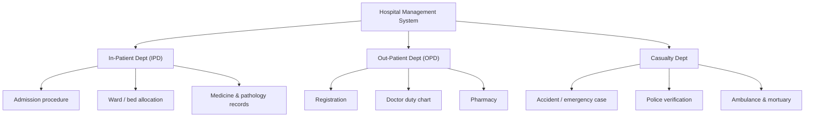

**Stakeholder mapping (common exam question):**

| System | Stakeholders |
|---|---|
| Payroll System | Employees, accountant, cashier, registrar, principal, income-tax personnel |
| Railway Reservation System | Passenger, train conductor, ticket-counter clerk, government/railway authority |
| Hospital Management System | Patients, doctors, nurses, ward staff, police, technicians, support staff |

---

### 1.2 SDLC and Process Models

**SDLC (Software Development Life Cycle)** is a framework of ordered phases: Requirements → Design → Coding → Testing → Deployment → Maintenance. The **model** chosen decides *when* testing happens, how much re-testing is needed, and how the STLC maps onto development.

#### Waterfall
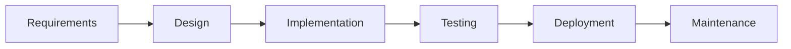
- Strictly sequential; a phase starts only when the previous one is complete. Associated with Winston Royce's 1970 paper (which itself described the flaws of a purely sequential flow).
- **Testing implication:** testing is a single late phase, so defects are found late, when they are costliest to fix. (Boehm's cost-of-change curve shows fix cost rising steeply by phase; the exact multiplier is debated, the trend is not.)
- **Fits:** stable requirements, short projects, mature technology.
- **Pros:** simple, predictable, easy to track. **Cons:** no room for change; risk surfaces late; poor for large, evolving systems.

#### V-Model *(Added: the model that formalizes test levels)*
Every development phase has a matching test level planned **in parallel**, so test design starts as soon as each specification exists.

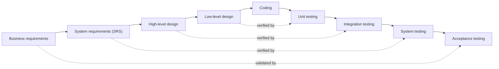

| Development phase | Matching test level | Test basis |
|---|---|---|
| Business requirements (BRS) | Acceptance testing | Business/user needs |
| System requirements (SRS) | System testing | Functional + non-functional spec |
| High-level design (architecture) | Integration testing | Module interfaces |
| Low-level design | Unit testing | Module logic |

#### Prototyping
- Builds a working mock-up early and refines it with customer feedback before full development.
- **Fits:** unclear or volatile requirements; novel UI. **Pros:** cuts requirement-misunderstanding risk, early user validation. **Cons:** costly, heavy customer involvement, risk of a throwaway prototype being shipped as the product.

#### Incremental
- The system is built and delivered in working slices; each increment runs its own analysis → design → code → test cycle.
- **Fits:** large but prioritizable scope; early releases wanted. **Pros:** faster time-to-market, continuous feedback. **Cons:** architecture can fragment across increments if unmanaged; every increment needs regression testing.

#### Agile
- Codified by the **Agile Manifesto (2001)**; roots include Scrum (1995), Extreme Programming (1996), DSDM (1994), Feature-Driven Development and Adaptive Software Development.
- Values: working software over comprehensive documentation; responding to change over following a plan; customer collaboration; individuals and interactions.
- **Testing implication:** testing is continuous and embedded in every sprint (whole-team quality), enabling TDD and CI/CD with automated regression (see Unit IV §4.13).

#### Object-Oriented SDLC
- Requirements are mapped to objects and their interactions; cycle is OO analysis → OO design → OO programming → testing. The same object model is reused end to end, improving reuse and traceability.

| Model | Testing happens | Change tolerance | Best for |
|---|---|---|---|
| Waterfall | Late, single phase | Very low | Stable, small projects |
| V-Model | Planned early, executed late | Low | Safety/regulated projects needing traceability |
| Prototype | Early on prototype, later on product | High | Unclear requirements |
| Incremental | Per increment | Medium | Large, prioritizable scope |
| Agile | Continuous, every sprint | Very high | Evolving requirements, frequent releases |

---

### 1.3 What Is Software Testing?

**Definition:** a planned process of evaluating a work product, by **static** activities (reviews, analysis, no execution) and **dynamic** activities (execution), to find defects and to judge whether it satisfies specified requirements and is fit for purpose.

**Why it is hard:** the input space, state space and environment space (OS × browser × device × configuration) explode combinatorially, so exhaustive testing is impossible (Principle 2).

| Term | Meaning | Focus |
|---|---|---|
| **Testing** | Finding defects and evaluating quality | Detection |
| **Debugging** | Locating the cause of a defect and fixing it (developer activity) | Correction |
| **QA (Quality Assurance)** | Process-oriented, preventive activities that build quality into the process | Prevention |
| **QC (Quality Control)** | Product-oriented activities (testing is one) that check the product | Detection |

> **Common confusion:** *Testing ≠ debugging.* Testing exposes the failure; debugging finds and removes the cause.

### 1.4 Verification vs. Validation

| | **Verification** | **Validation** |
|---|---|---|
| Question | "Are we building the product **right**?" | "Are we building the **right** product?" |
| Checks against | Specifications and standards | Actual user/business needs |
| Method | Static: reviews, walkthroughs, inspections, static analysis | Dynamic: executing the software |
| Timing | Throughout development, before execution is possible | After executable software exists |
| Examples | SRS review, code inspection | System test, UAT |

### 1.5 Goals of Software Testing

| Horizon | Goals |
|---|---|
| **Immediate** | Bug discovery, bug prevention |
| **Long-term** | Reliability, product quality, customer satisfaction, risk management |
| **Post-implementation** | Lower maintenance cost, improved future test process |

Post-release defects cost more (production patching, hot-fix pipelines, reputational damage), which is the economic case for **shift-left** testing: test earlier.

### 1.6 Seven Testing Principles (ISTQB)

| # | Principle | Practical implication |
|---|---|---|
| 1 | **Testing shows the presence of defects, not their absence** | Passing tests lower risk but never prove zero defects |
| 2 | **Exhaustive testing is impossible** | Use risk and priority to choose tests; use EP/BVA to shrink the input space |
| 3 | **Early testing saves time and money** | Review requirements and design (static testing) before code exists |
| 4 | **Defect clustering** | A few modules hold most defects (roughly the Pareto 80/20 pattern, an empirical tendency, not a law); focus effort there |
| 5 | **Pesticide paradox** | Repeating identical tests stops finding new bugs; review and refresh test cases regularly |
| 6 | **Testing is context-dependent** | Safety-critical medical software and a marketing site need different rigor and techniques |
| 7 | **Absence-of-errors fallacy** | A defect-free system built to the wrong requirements is still a failure |

### 1.7 Software Testing Life Cycle (STLC)

The STLC is the testing-specific counterpart of SDLC: six sequenced phases, each with **entry criteria** (what must be true to start) and **exit criteria** (what must be true to finish).

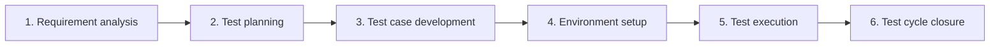

| Phase | Key activities | Entry criteria | Exit criteria / deliverables |
|---|---|---|---|
| **1. Requirement Analysis** | Study requirements for testability; identify test types and priorities; identify environment needs | Approved BRS/SRS available | Testable-requirement list, RTM draft, automation feasibility |
| **2. Test Planning** | Strategy, effort estimate, tool selection, roles, risks, schedule | Requirement analysis done | **Test Plan** approved |
| **3. Test Case Development** | Design and write test cases/scripts; prepare test data; review | Test plan approved | Reviewed test cases and test data |
| **4. Environment Setup** | Configure hardware/software; deploy build; run **smoke test** | Test plan and build available | Environment ready + smoke test passed |
| **5. Test Execution** | Run tests, log results, raise defects, retest fixes, update RTM | Ready environment, baselined test cases | Execution logs, defect reports |
| **6. Test Cycle Closure** | Check completion criteria (coverage, defect trend, time, cost); metrics; lessons learned | Execution complete | **Test Closure Report** |

> **Common confusion:** SDLC governs the whole product life; STLC governs only testing activities and runs alongside or nested within SDLC (in Agile, a mini-STLC per sprint).

### 1.8 Roles in a Test Organization

| Role | Responsibility |
|---|---|
| **Test Manager / Lead** | Owns test process, planning, staffing, reporting |
| **Test Architect** | Designs test architecture, frameworks, reusable assets for complex projects |
| **Test Designer / Analyst** | Derives test conditions and cases; measures coverage |
| **Tester** | Executes tests, logs defects, retests fixes |
| **Test Automation Engineer** | Builds and maintains automation scripts and infrastructure |
| **Test Methodologist / Process Owner** | Owns strategy, templates, process improvement |

### 1.9 Error, Defect, Failure

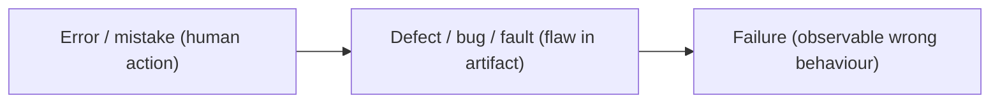

| Term | Definition | Example |
|---|---|---|
| **Error (mistake)** | Human action producing an incorrect result | Developer misreads the spec |
| **Defect (bug, fault)** | Flaw in a work product caused by an error | `if (age > 18)` where spec says `>= 18` |
| **Failure** | Deviation from expected behaviour observed when the defect executes | 18-year-old is rejected at run time |

Not every defect causes a failure (e.g., dead code, or a path never triggered). The **root cause** is the earliest error or process gap that led to the defect.

#### Defect Classification by Origin

| Category | Sub-types | Example |
|---|---|---|
| **Requirement & specification** | Functional-description defects (ambiguous I/O); feature defects (missing NFR, e.g., performance); feature-interaction defects; interface-description defects | "Add customer" and "customer classification" specified separately but interacting |
| **Design** | Algorithmic/processing; control/logic/sequence; data (wrong structure/type/size); module-interface (wrong parameter count/type); external-interface defects | `a + b / 2` designed instead of `(a + b) / 2` |
| **Coding** | Algorithmic (sign, overflow/underflow, precedence); control/logic; typographical/syntax; initialization; data-flow; module-interface; documentation; external HW/SW interface | Uninitialized loop counter causing off-by-one |
| **Testing** | Test-harness/scaffolding defects; test-case/procedure defects (wrong, incomplete, missing) | Test oracle computes a wrong expected result |

> **Added: phase containment.** Defects should be found in the phase where they were injected. Defects that *escape* to later phases (or production) are called **leakage**; see metrics in §1.11.

### 1.10 Defect Management and Life Cycle

**Process:** Discovery → Reporting → Categorization (severity/priority) → Resolution → Verification (retest) → Closure. The purpose is to feed information back into development, not just log and forget.

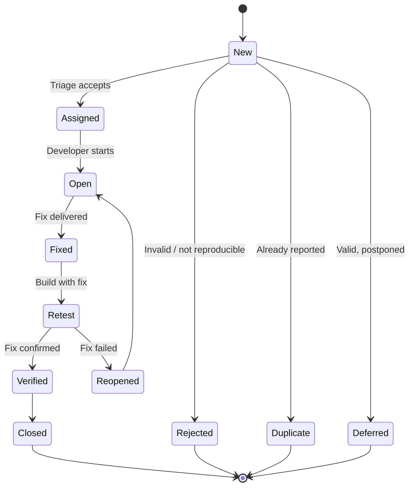

| State | Meaning |
|---|---|
| **New** | Logged, not yet triaged |
| **Assigned** | Routed to a developer/team |
| **Open / Active** | Developer working on the fix |
| **Fixed / Test** | Fix delivered, awaiting QA |
| **Retest → Verified** | QA confirms the fix works |
| **Closed** | Confirmed resolved (final state) |
| **Reopened** | Fix insufficient; returns to Open |
| **Rejected** | Not a defect, or not reproducible |
| **Duplicate** | Same as an existing defect |
| **Deferred** | Valid but postponed to a later release |

State names vary by tool (Jira, Bugzilla); the flow is what matters. **Exam tip:** always draw *Reopened → Open* and mention Rejected/Deferred as side exits.

#### Severity vs. Priority

| | **Severity** | **Priority** |
|---|---|---|
| Meaning | Technical impact of the defect on the system | Business urgency of fixing it |
| Set by | Tester / QA | Product owner / manager |
| Levels | Critical, Major, Minor, Trivial | High, Medium, Low |

| Combination | Example |
|---|---|
| High severity, high priority | Payment fails at checkout |
| High severity, low priority | Crash in a rarely used legacy export feature |
| Low severity, high priority | Company name misspelled on the home page |
| Low severity, low priority | Minor alignment issue on an unvisited admin page |

#### Defect Report: Essential Fields
ID · title · environment/build · steps to reproduce · expected vs actual result · severity · priority · status · attachments (logs, screenshots) · reporter/assignee · date.

### 1.11 Test Metrics *(Added)*

| Metric | Formula |
|---|---|
| Requirement coverage | Requirements with ≥ 1 test ÷ total requirements × 100 |
| Test execution progress | Tests executed ÷ tests planned × 100 |
| Pass rate | Tests passed ÷ tests executed × 100 |
| Defect density | Defects found ÷ size (KLOC or function points) |
| Defect Removal Efficiency (DRE) / Defect Detection Percentage | Defects found before release ÷ (found before + found after release) × 100 |
| Defect leakage | Defects found in later phase/production ÷ total defects × 100 |

### Exam Focus: Unit I
- Differentiate error, defect, failure with an example.
- Draw and explain the bug life cycle; distinguish severity from priority.
- State and justify any four testing principles.
- Compare Waterfall, V-model and Agile from a testing viewpoint.
- Explain STLC phases with entry/exit criteria.
- Verification vs validation; QA vs QC.

---

## Unit II: Types of Testing

### 2.1 Classification: Testing Is Classified Along Several Independent Axes

The original tree mixes axes; separating them avoids confusion.

| Axis | Categories |
|---|---|
| **Execution approach** | Manual · Automated |
| **Knowledge of internals** | White-box · Black-box · Gray-box |
| **Test level** | Unit · Integration · System · Acceptance |
| **Test objective (type)** | Functional · Non-functional (performance, usability, security, compatibility, etc.) · Change-related (confirmation, regression) |

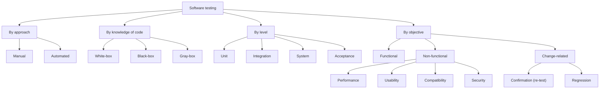

> **Exam tip:** Any test level can use any knowledge approach and any objective. Example: a *system-level*, *black-box*, *performance* test.

### 2.2 White-Box, Black-Box, Gray-Box

| | **White-box** (structural, glass-box) | **Black-box** (behavioural, specification-based) | **Gray-box** |
|---|---|---|---|
| Test basis | Internal code and design | Requirements and observable behaviour | Requirements + partial internals (schema, architecture, API contracts) |
| Tester skill | Programming needed | No code knowledge needed | Some technical knowledge |
| Typical level | Unit (and some integration) | System, acceptance | Integration, security, web/API |
| Techniques | Statement, branch, condition, path coverage | EP, BVA, decision table, state transition, use case | Matrix testing, pattern testing, DB-aware end-to-end tests |
| Finds | Logic errors, dead code, security holes, untested paths | Missing/incorrect functions, interface errors, behaviour errors | Data-flow and integration defects |
| Weakness | Cannot find *missing* functionality; costly, needs tools | Hard to hit obscure inputs; may repeat developer's unit tests | Limited by partial knowledge |

### 2.3 Manual vs. Automation

| Criterion | Manual | Automation |
|---|---|---|
| Executor | Human tester | Scripts/tools |
| Best for | Exploratory, usability, ad-hoc, one-off tests, new features | Regression, load/performance, cross-browser, build-verification, data-driven tests |
| Initial cost | Low | High (tools, scripting, framework) |
| Long-run cost | High for repeated runs | Low once scripts are stable |
| Reliability on repetition | Falls with fatigue | Consistent |
| UI/UX judgment | Strong | Weak (no human perception) |
| Maintenance | None | Scripts break when the UI changes (flaky/brittle tests) |

**When to automate:** stable features, high-repetition tests, large data sets, tests needing precision or parallel runs. **When not to:** rapidly changing UI, one-time tests, usability/visual judgment.

### 2.4 Test Levels (Functional Testing)

#### Unit Testing
- Tests the smallest testable unit (function, method, class) in isolation, normally by the developer.
- **Isolation uses test doubles:** *stub* (returns canned answers), *mock* (verifies interactions/calls), *fake* (lightweight working implementation, e.g., in-memory DB), *spy* (records calls), *dummy* (fills a parameter).
- **Workflow:** create test → review → baseline → execute.
- **Tools:** JUnit, TestNG, NUnit, PHPUnit, pytest, Jest.
- **Pros:** earliest and cheapest fix point; enables safe refactoring. **Cons:** effort to write and maintain; does not test integration or non-functional qualities; cannot prove absence of defects.

#### Integration Testing
Tests interfaces and interactions between separately tested units.

| Approach | Description | Needs | Pros | Cons |
|---|---|---|---|---|
| **Top-down** | Start from top modules, move downward | **Stubs** for missing lower modules | Early check of main control flow | Low-level modules tested late; many stubs |
| **Bottom-up** | Start from low-level modules, move upward | **Drivers** for missing upper modules | Early testing of foundational modules | Top-level flow tested late |
| **Big-bang** | Integrate everything, then test | None up front | Simple for small systems | Hard to isolate the failing interface |
| **Sandwich / hybrid** | Top-down and bottom-up meeting in the middle | Both | Balanced, parallel | More complex planning |

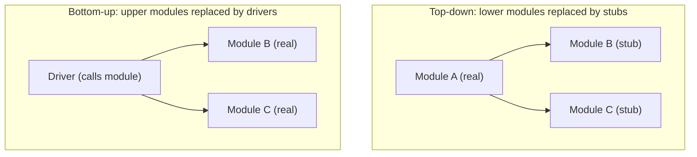

> **Mnemonic:** **S**tubs stand **u**nder (replace called, lower modules); **D**rivers **d**rive from above (replace calling, upper modules).

#### System Testing
- Validates the fully integrated system end to end against the SRS, covering functional and non-functional requirements (performance, security, reliability, compatibility).
- Performed in a production-like environment by an independent test team. **Cons:** can overlap earlier levels; needs a complete environment.

#### Acceptance Testing
- Final gate: decides whether the system can be accepted for delivery/release. Performed by customers, end-users or their representatives.

| Type | Description |
|---|---|
| **UAT (User Acceptance Testing)** | Formal user sign-off against business needs |
| **Alpha testing** | In-house, by internal staff/independent testers, before external release |
| **Beta testing** | Real users in a real environment before general availability |
| **Contractual / regulatory acceptance** | Against contract terms or legal/regulatory standards |
| **OAT (Operational Acceptance)** | Backup/restore, maintainability, security procedures, admin readiness |

### 2.5 Non-Functional Testing
Checks **how well** the system behaves, not **whether** it does a function. Example: functional: "does login succeed?"; non-functional: "how many concurrent logins can it sustain within 2 s?"

| Type | Question answered |
|---|---|
| **Performance** | Is it fast, stable and scalable enough? |
| **Usability** | Is it easy to learn and use? Are users satisfied? |
| **Compatibility** | Does it work across browsers, OS, devices, versions? |
| **Security** | Are confidentiality, integrity, authentication, authorization preserved? |
| **Reliability** | Does it run without failure for a specified time? |
| **Accessibility** | Usable by people with disabilities (WCAG)? |
| **Localization / Internationalization** | Correct behaviour across languages, currencies, date formats? |
| **Maintainability / Portability** | Easy to modify / move to another platform? |

#### Performance Testing Subtypes

| Subtype | Load applied | Objective |
|---|---|---|
| **Load** | Expected/peak realistic load | Confirm targets are met |
| **Stress** | Beyond capacity | Find the breaking point and check graceful degradation/recovery |
| **Spike** | Sudden sharp surge | Test behaviour on abrupt load change |
| **Soak / Endurance (stability)** | Normal load for a long period | Detect memory leaks, resource exhaustion |
| **Scalability** | Increasing load with added resources | Measure how capacity grows |

**Key metrics:** response time (use percentiles, e.g., p95/p99, not just averages), throughput (requests/sec), latency, error rate, resource utilization (CPU, memory, I/O), concurrent users.

### 2.6 Change-Related Testing

| | **Confirmation (Re-testing)** | **Regression** |
|---|---|---|
| Purpose | Verify a specific **fixed defect** is really fixed | Verify the change did **not break** existing functionality |
| Test cases | The **failed** test(s) re-run | Previously **passed** tests |
| Scope | Narrow | Broad (selected or full suite) |
| Automation | Usually manual, one-time | Prime candidate for automation |

**Regression triggers:** new feature, defect fix, performance optimization, patch, configuration change, environment change.
**Strategies:** *retest-all* (safest, slowest) · *regression test selection* (impact analysis + RTM) · *test case prioritization* (highest-risk first under time pressure).

| | **Smoke testing** | **Sanity testing** |
|---|---|---|
| Purpose | Is the build stable enough to test at all? | Is the specific change/fix reasonable and working? |
| Scope | Broad and shallow (critical paths) | Narrow and deep (affected area) |
| When | On every new build, before detailed testing | After a minor change or fix |
| Scripted | Often (automated) | Often unscripted |

### 2.7 Test Automation

**Benefits:** faster execution and shorter cycles, unattended/overnight and parallel runs, elimination of manual slips, consistency, more frequent releases, reusable regression suites.
**Risks:** high upfront cost, script maintenance when the UI changes, false confidence (automation only checks what it is told to check), flaky tests from timing/environment issues.

**Framework types:** linear (record/playback) → modular → data-driven → keyword-driven → hybrid; design patterns such as **Page Object Model** keep locators separate from test logic to cut maintenance.

| Tool | Notes |
|---|---|
| **Selenium** | Open-source browser automation; WebDriver API; languages: Java, Python, C#, JS, Ruby; runs with JUnit/TestNG/pytest; Selenium Grid for parallel runs |
| **Playwright / Cypress** | Modern web-automation frameworks with auto-waiting and rich debugging |
| **Appium** | Mobile (Android/iOS) automation |
| **UFT (formerly QTP)** | Commercial functional-test tool (Micro Focus / OpenText) |
| **JMeter / LoadRunner** | Load and performance testing |
| **Postman / REST Assured** | API testing |
| **Ranorex Studio** | Codeless + code-based; desktop, web, mobile |
| **Kobiton** | Real-device mobile cloud lab |
| **LambdaTest** | Cross-browser cloud grid, parallel execution |
| **Avo Assure, testRigor, Subject7** | Codeless/natural-language test tools |
| **Jira, TestRail, Zephyr** | Test management / defect tracking |

> **Note:** vendor features change quickly; for exams remember the *category* and one distinguishing property per tool.

### Exam Focus: Unit II
- Black-box vs white-box vs gray-box (table above).
- Stub vs driver; top-down vs bottom-up; V-model level mapping.
- Load vs stress vs spike vs soak testing.
- Regression vs re-testing; smoke vs sanity.
- Alpha vs beta; when to automate.

---

## Unit III: Test Case Development

### 3.1 Core Terms

| Term | Meaning |
|---|---|
| **Test condition** | An item or event that could be verified (e.g., "login rejects an invalid password") |
| **Test scenario** | A high-level end-to-end situation to test ("user logs in") |
| **Test case** | Specific inputs, preconditions, steps, expected result and postconditions for one condition |
| **Test script** | Automated (or step-wise) implementation of a test case |
| **Test procedure** | Ordered sequence of test cases to execute together |
| **Test suite** | Collection of test cases grouped for a purpose (smoke suite, regression suite) |
| **Test oracle** | Source of the **expected result** (spec, prior version, calculation, domain expert) |
| **Test data** | Inputs the test consumes |

Derivation flow: **test basis → test conditions → test cases → test procedures/scripts**.

### 3.2 Test Documentation

| Document | Purpose | Level |
|---|---|---|
| **Test Policy** | Organization-wide goals and principles of testing | Organization |
| **Test Strategy** | General approach: which levels/types/techniques/tools, independent of one project | Organization or program |
| **Test Plan** | Project-specific: scope, approach, resources, schedule, risks, entry/exit criteria | Project / level |
| **Test Design Specification** *(Added)* | Conditions/features to be tested and the technique used | Level |
| **Test Case / Procedure** | Detailed steps, data, expected results | Detail |
| **Test Log / Execution Report** | What was run and the results | Execution |
| **RTM** | Maps requirements to test cases (coverage proof) | Cross-cutting |
| **Defect / Incident Report** | Records a failure and its details | Execution |
| **Test Summary / Closure Report** | Results, coverage, residual risk, lessons learned | Closure |

> **Common confusion:** Policy → Strategy → Plan is a **scope hierarchy** (organization-wide → project-specific), not a sequence that includes RTM or defect reports. The list follows IEEE 829, now superseded by ISO/IEC/IEEE 29119-3.

- **Advantages of documentation:** removes ambiguity in allocation, serves as training material, aids repeatability and audits, improves client transparency.
- **Disadvantages:** costly and slow to produce, tedious to keep current, quality depends on author (mitigation: templates, reviews, lightweight documentation in Agile).

### 3.3 Anatomy of a Test Case

| Field | Purpose |
|---|---|
| Test Case ID | Unique identifier (e.g., `TC_LOGIN_001`) |
| Title / Description | What is verified |
| Requirement ID | Link to RTM |
| Pre-condition | State required before execution (e.g., account exists, browser open) |
| Test Steps | Numbered actions |
| Test Data | Concrete inputs |
| Expected Result | Behaviour per requirement (from the oracle) |
| Actual Result | Observed behaviour |
| Status | Pass / Fail / Blocked / Not run |
| Post-condition | State after execution (e.g., session created, audit log entry) |
| Priority, Type, Author, Date | Management metadata |

**Worked example: login feature (positive and negative cases):**

| ID | Description | Pre-condition | Steps | Test data | Expected result | Type |
|---|---|---|---|---|---|---|
| TC_LOGIN_001 | Login with valid credentials | Registered user exists | 1. Open login page 2. Enter user ID 3. Enter password 4. Click **Submit** | ID: `kk`, Pwd: `kk1` | User lands on dashboard; session created | Positive |
| TC_LOGIN_002 | Login with wrong password | Registered user exists | Same steps | ID: `kk`, Pwd: `wrong` | Error "Invalid credentials"; no session | Negative |
| TC_LOGIN_003 | Login with empty fields | Login page open | Click **Submit** with both blank | (none) | Field-level validation messages shown | Negative |
| TC_LOGIN_004 | Account locks after repeated failures | Registered user exists | Submit wrong password 3 times | Pwd: `wrong` ×3 | Account locked; correct password now refused | Negative / boundary |

Note that a good suite mixes positive and negative cases; the slide example had only the happy path.

### 3.4 Best Practices for Writing Test Cases
- Simple, unambiguous, one objective per test case; **independent** of other tests where possible.
- **Traceable** to a requirement, with an identifiable ID; **repeatable** by anyone.
- Written from the **end-user's viewpoint**; do not assume undocumented behaviour.
- Cover positive, negative and boundary conditions; aim for **100% requirement coverage** and derive cases with recognized techniques (Unit IV).
- Keep short (rule of thumb ≤ 15 steps); **self-cleaning** (leave no residual data/state).
- **Peer-review** cases and keep them under version control; retire or update obsolete ones (avoids pesticide paradox).

### 3.5 Test Analysis: Sources of Test Conditions

| Source | Written by | Content | Answers |
|---|---|---|---|
| **BRS (Business Requirement Specification)** | Business analysts with client | Business needs and goals, in business language | *What does the business need?* |
| **SRS (Software Requirement Specification)** | Analysts/architects | Functional + non-functional requirements, external interfaces, constraints | *What must the software do and how well?* |
| **FDD (Functional Design Document)** | Designers | How the system will operate for users, with minimal jargon; reviewed and signed off | *How will it work?* |

Typical flow: **BRS → SRS → FDD / design docs → code**. Testers trace test cases back to the most granular of these for each requirement. Ambiguities found while analyzing requirements are themselves early defects (static testing).

### 3.6 Requirement Traceability Matrix (RTM)

**Definition:** a table mapping **Business Requirement → Functional Requirement → Priority → Test Case ID(s) → (Defect IDs)**, proving every requirement is tested.

| BRS ID | SRS ID | Requirement | Priority | Test Case IDs | Status |
|---|---|---|---|---|---|
| BR-01 | FR-01 | Registered user can log in | High | TC_LOGIN_001–004 | Passed |
| BR-01 | FR-02 | Lock account after 3 failed attempts | High | TC_LOGIN_004 | Failed (DEF-12) |

- **Forward traceability:** requirement → test case (proves coverage).
- **Backward traceability:** test case → requirement (finds tests with no requirement, i.e., scope creep).
- **Bidirectional:** both.
- **Uses:** coverage proof, **impact analysis** (which tests to re-run when a requirement changes), audit evidence.
- **Creation:** (1) define goal, (2) identify artifacts to link, (3) populate in Excel or a test-management tool.

### 3.7 Test Data

| Category | Meaning | Example (Age 18–60) |
|---|---|---|
| **Valid** | Accepted and processed normally | 35 |
| **Boundary / extreme** | At the edges of allowed ranges | 17, 18, 60, 61 |
| **Invalid / erroneous** | Must be rejected or handled gracefully | −5, `abc`, blank, 9999 |

- **Generation:** manual (spreadsheets), scripted, synthetic **test data generators**, or masked/anonymized copies of production data.
- **Data privacy:** never use raw production personal data in test environments; use masking or synthetic data (relevant under India's DPDP Act 2023, GDPR, HIPAA).

### 3.8 Test Case Management Tools (TCMT)
Manage the full lifecycle: template-based authoring, suite organization, execution tracking, **defect linking** and end-to-end traceability (requirement ↔ test ↔ run ↔ defect), dashboards and reports, and protection of test assets. Examples: **Jira (with Xray/Zephyr), TestRail, HP/OpenText ALM (Quality Center), qTest**.

### Exam Focus: Unit III
- Write test cases for a given feature (login, ATM withdrawal, registration form).
- Test case vs test scenario; test plan vs test strategy.
- BRS vs SRS vs FDD.
- What is an RTM, and how does it support impact analysis?
- Pros and cons of test documentation.

---

## Unit IV: Testing Techniques

### 4.1 What a Technique Does
A test technique is a systematic way to **derive test conditions and cases** so that a small, effective set of tests achieves good coverage (the practical answer to Principle 2: exhaustive testing is impossible). A technique is characterized by **who** applies it, **what coverage** it targets, **what defects** it tends to find, **how** it is applied and **how results are evaluated**.

Guiding principles: tests trace to requirements; testing is risk-based; plan before executing; start small (unit) and extend outward; concentrate on defect-prone areas (clustering); use independent testers where possible.

### 4.2 Classification of Techniques

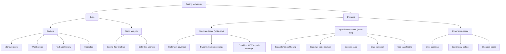

### 4.3 Static Testing

| | **Static** | **Dynamic** |
|---|---|---|
| Code executed? | No | Yes |
| When | Very early (requirements, design, code) | After runnable code exists |
| Finds | Defects (ambiguity, standards violations, dead code, data-flow anomalies) | Failures |
| Cost | Cheaper per defect found | More expensive |

| Review type | Formality | Characteristics |
|---|---|---|
| **Informal review** | Lowest | No defined process; ad hoc feedback |
| **Walkthrough** | Low–medium | Led by the **author**; used for learning and consensus |
| **Technical review** | Medium–high | Peers check against standards/specs; led by trained moderator |
| **Inspection** | Highest | Defined roles (moderator, author, reader, scribe, inspectors), checklists, entry/exit criteria, metrics collected |

**Static analysis (tool-based):** *control-flow analysis* (call structure, unreachable code, infinite loops); *data-flow analysis* (define-use-kill anomalies, such as using an uninitialized variable). Tools: SonarQube, ESLint, Checkstyle, SpotBugs, Pylint.

### 4.4 Structure-Based (White-Box) Techniques

**Coverage** = (items exercised ÷ total items) × 100.

| Technique | Requirement for 100% |
|---|---|
| **Statement coverage** | Every executable statement runs at least once |
| **Branch / decision coverage** | Every decision takes both **True** and **False** outcomes |
| **Condition coverage** | Every atomic Boolean condition is both True and False |
| **Condition/decision coverage** | Both of the above |
| **MC/DC** (Modified Condition/Decision Coverage) | Each condition is shown to **independently** affect the decision outcome; needs **N + 1** tests for N conditions (required for avionics, DO-178C Level A) |
| **Multiple-condition coverage** | Every combination of condition outcomes (2ⁿ) |
| **Path coverage** | Every independent path through the control-flow graph |

**Subsumption (strength):** statement < branch < condition/decision < MC/DC < multiple-condition < path. 100% branch coverage guarantees 100% statement coverage, but not the reverse.

**Worked example:**

```text
1  read(x, y)
2  if (x > 0 AND y > 0)      // decision D with conditions C1: x>0, C2: y>0
3      z = x + y
4  else
5      z = 0
6  print(z)
```

| Test | (x, y) | C1 | C2 | D | Notes |
|---|---|---|---|---|---|
| T1 | (1, 1) | T | T | True | Covers lines 1, 2, 3, 6 |
| T2 | (−1, 1) | F | T | False | Covers line 5 |
| T3 | (1, −1) | T | F | False | |
| T4 | (−1, −1) | F | F | False | |

- **Statement coverage 100%:** T1 + T2.
- **Branch coverage 100%:** T1 + T2 (D takes True and False).
- **Condition coverage 100%:** T3 + T2 alone give C1 = {T, F} and C2 = {F, T}, yet D is **never True**. This shows condition coverage does *not* imply branch coverage.
- **MC/DC:** T1, T2, T3 (3 = N + 1 tests). T1 vs T2 isolates C1; T1 vs T3 isolates C2.
- **Multiple-condition:** all four tests.

**Cyclomatic complexity (McCabe):** V(G) = E − N + 2P (edges, nodes, connected components) = number of decision points + 1. It gives the number of linearly independent paths, i.e., the minimum tests for **basis-path testing**, and flags overly complex, defect-prone modules (V(G) > 10 is a common refactoring flag).

### 4.5 Boundary Value Analysis (BVA)

**Rationale:** defects cluster at the edges of ranges (off-by-one, `<` vs `<=`), so test the boundaries.

**Rule (3-value BVA)** for valid range `[min, max]`: test `min−1, min, min+1, max−1, max, max+1`. (2-value BVA tests only `min−1, min, max, max+1`.)

**Worked example:** Age field accepting integers 18–60.

| Value | Position | Expected |
|---|---|---|
| 17 | Just below min | Rejected |
| 18 | Min boundary | Accepted |
| 19 | Just above min | Accepted |
| 59 | Just below max | Accepted |
| 60 | Max boundary | Accepted |
| 61 | Just above max | Rejected |

Also applies to lengths (password 8–16 characters), dates, quantities, file sizes and numeric limits.

### 4.6 Equivalence Partitioning (EP)

**Rationale:** inputs that the system treats the same way form a partition; one representative value from each is as good as any other, so tests are drastically reduced without losing partition-level coverage.

**Rule:** split the domain into **valid** and **invalid** partitions; choose one representative per partition. Also consider partitions on non-numeric invalids (text, blank, special characters).

**Worked example:** Age 18–60.

| Partition | Range | Representative |
|---|---|---|
| Invalid (too low) | < 18 | 10 |
| **Valid** | 18–60 | 35 |
| Invalid (too high) | > 60 | 75 |
| Invalid (non-numeric) | letters/blank | `abc` |

**EP + BVA together:** EP selects the partitions; BVA stresses their edges. **Coverage** for EP = partitions tested ÷ total partitions.

### 4.7 Decision Table Testing

**Use when:** behaviour depends on **combinations of conditions** (business rules). List conditions, actions and every rule (2ⁿ for n binary conditions); each rule becomes a test case. Merge rules with "don't care" (–) entries to shrink the table.

**Example:** *10% discount if the customer is a Member AND the order total exceeds ₹1000.*

| Rule | R1 | R2 | R3 | R4 |
|---|---|---|---|---|
| **Member?** | Y | Y | N | N |
| **Order > ₹1000?** | Y | N | Y | N |
| **Apply 10% discount** | **Yes** | No | No | No |

Since only R1 gives the discount, R2–R4 can collapse to `Member? = – / Order? = –` **when** not both Y; but keep all four when each combination is independently risky. Tests: (Member, ₹1500), (Member, ₹500), (Non-member, ₹1500), (Non-member, ₹500).

### 4.8 State Transition Testing

**Use when:** the response to an input **depends on the current state** (history matters). Model: states, events (inputs), transitions, guards (conditions), actions.

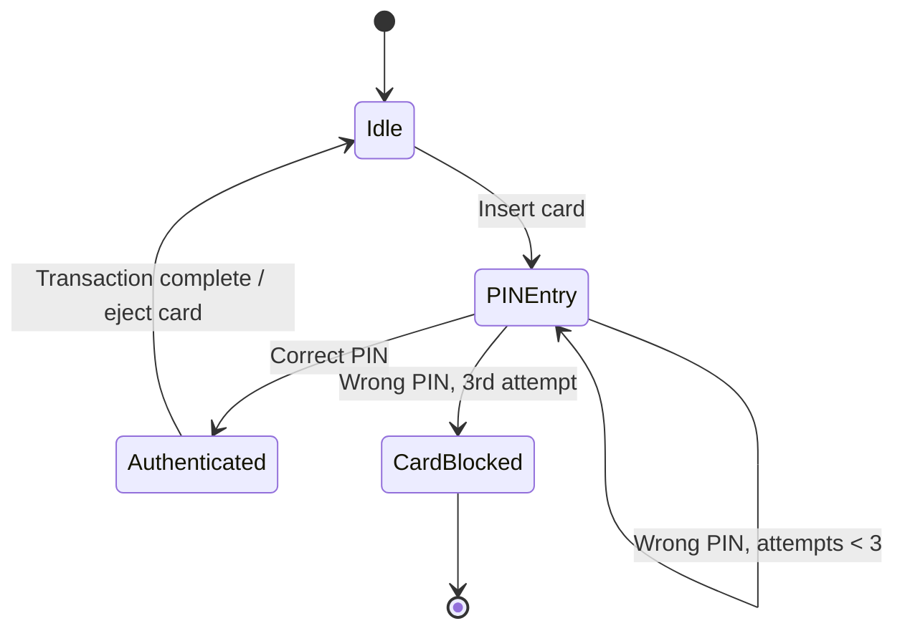

**State table** (also reveals invalid transitions to test):

| Current state | Insert card | Correct PIN | Wrong PIN |
|---|---|---|---|
| Idle | → PINEntry | Invalid (ignored) | Invalid (ignored) |
| PINEntry | Invalid | → Authenticated | → PINEntry (count++) or → CardBlocked at 3rd |
| Authenticated | Invalid | Invalid | Invalid |
| CardBlocked | Invalid | Invalid | Invalid |

**Coverage levels:** *all states* < *all valid transitions* (0-switch) < *sequences of two transitions* (1-switch) < … *all transition pairs including invalid ones* (state-table coverage). Example tests: valid path Idle → PINEntry → Authenticated; 3 consecutive wrong PINs → CardBlocked; correct PIN on the 3rd attempt still authenticates; correct PIN after the card is blocked is refused.

### 4.9 Use Case Testing

**Use when:** deriving tests from actor–system interactions to check end-to-end business flows. Each use case has a **main (basic) flow** and **alternate/exception flows**; each flow yields at least one test.

**Example: Book a Movie Ticket**

| Flow | Steps / trigger | Expected |
|---|---|---|
| Main | Select movie → choose seats → pay → confirmation | Ticket issued, seats marked booked |
| Alt 1 | Seats taken by another user during selection | Message shown; user re-selects |
| Alt 2 | Payment fails | Booking not confirmed; seats released |
| Alt 3 | Session times out | Selection cleared; user redirected |

### 4.10 Other Black-Box Techniques *(Added)*
- **Pairwise / combinatorial testing:** test all pairs of parameter values instead of all combinations (e.g., browser × OS × language), since most defects arise from interactions of two parameters.
- **Cause-effect graphing:** map causes (inputs) to effects (outputs) with Boolean logic and convert to a decision table.
- **Error-handling and negative testing:** deliberately invalid inputs and failure injection.

### 4.11 Experience-Based Techniques
- **Error guessing:** derive tests from experience of typical mistakes (null, zero, empty string, very large values, special characters, division by zero, leap-year dates). Often formalized as a **fault attack** list.
- **Exploratory testing:** simultaneous learning, test design and execution, guided by a **charter** and time-boxed (session-based test management). Best for poorly specified systems and to supplement scripted tests.
- **Checklist-based testing:** tests derived from a maintained checklist of conditions (UI checklists, security checklists).

### 4.12 Choosing a Technique

| Situation | Technique |
|---|---|
| Numeric ranges, lengths, ordered domains | EP + BVA |
| Business rules with multiple interacting conditions | Decision table |
| Behaviour depends on history/state, workflows | State transition |
| End-to-end user scenarios | Use case testing |
| Measuring code-level thoroughness | Structure-based coverage |
| Poor documentation or time pressure | Exploratory, error guessing |
| Requirements/design documents | Reviews, inspections |

### 4.13 Agile Testing
- Testing is a **whole-team** activity and happens continuously inside each sprint; testers join backlog refinement to define **acceptance criteria** early.
- **TDD (Test-Driven Development):** *Red* (write a failing test) → *Green* (write minimal code to pass) → *Refactor*. Produces unit tests first, by developers.
- **BDD (Behaviour-Driven Development):** scenarios in business-readable **Given / When / Then** form (Gherkin; tools: Cucumber, SpecFlow, Behave) shared by business, dev and QA; doubles as automated acceptance tests.

```gherkin
Scenario: Account locks after three wrong PINs
  Given a card with PIN 1234 is inserted
  When the user enters a wrong PIN three times
  Then the card is blocked
```

- **Test automation pyramid:** many fast **unit** tests at the base, fewer **integration/API** tests in the middle, very few slow **UI/end-to-end** tests at the top. This keeps CI/CD feedback fast and cheap.

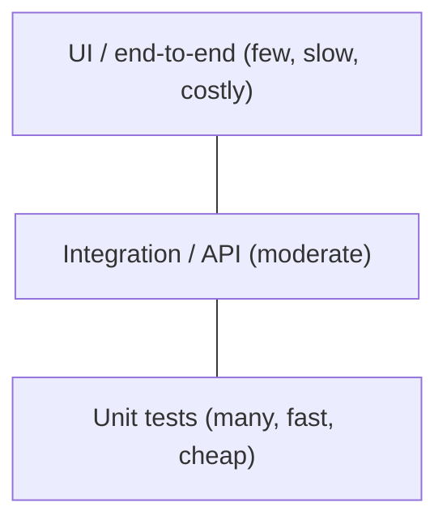

- **CI/CD:** each commit triggers build + automated unit, integration and smoke tests; a failing test blocks the pipeline. Regression suites run continuously.
- **Agile testing quadrants (Marick/Crispin):** Q1 technology-facing tests supporting the team (unit, component); Q2 business-facing tests supporting the team (functional, story tests); Q3 business-facing tests critiquing the product (exploratory, UAT, usability); Q4 technology-facing tests critiquing the product (performance, security).

### 4.14 Risk-Based Testing *(Added)*
**Risk = likelihood of failure × impact of failure.** Rank features by risk; allocate more depth, earlier execution and stronger techniques to high-risk areas. This is the operational form of "exhaustive testing is impossible": when time runs out, the highest risks have already been tested.

### Exam Focus: Unit IV
- Generate test cases for a field/range using EP + BVA (state the range, list partitions and boundary values).
- Build a decision table from a business rule and derive test cases.
- Draw a state-transition diagram for ATM/login/order status and list valid and invalid transitions.
- Compute statement/branch coverage for a code snippet; explain why condition coverage ≠ branch coverage.
- Static vs dynamic; walkthrough vs inspection; TDD vs BDD.

---

## Unit V: Testing Different Domains

**Why domain testing?** Generic functional and non-functional testing is not enough. Each industry has specific regulations, workflows, data standards and risk profiles. **Domain knowledge** shortens tester training, speeds defect triage, improves test design and makes business rules and terminology easier to validate.

### 5.1 Web Domain

Built on HTML/CSS/JavaScript with a client ↔ web server ↔ application server ↔ database architecture; may be static or dynamic, single- or multi-page, or a progressive web app.

| Area | What is checked |
|---|---|
| **Functionality** | Links (internal, external, mailto, anchor, broken links); forms (validation, defaults, DB writes); cookies and sessions; end-to-end workflows; negative scenarios |
| **Usability** | Navigation consistency, content quality, `alt` text, responsive design, error messages; **accessibility (WCAG)** |
| **Interface** | Web ↔ app ↔ database hand-offs; correct requests/responses; errors shown to admins/logs, not raw to users; timeouts handled |
| **Database** | Query correctness, CRUD integrity, transaction handling, query performance |
| **Compatibility** | Browsers (Chrome, Firefox, Safari, Edge), OS, devices, screen sizes, versions |
| **Performance** | Load/stress at varied network speeds, caching, compression, page load time (Core Web Vitals) |
| **Security** | Authentication/authorization, session timeout, HTTPS/SSL redirection, protection of restricted files, **OWASP Top 10** (injection, XSS, CSRF, broken access control) |

**Tools:** Selenium, Playwright, Cypress (functional); JMeter (load); OWASP ZAP, Burp Suite (security); Lighthouse (performance/accessibility); BrowserStack/LambdaTest (compatibility). **Crowd testing** uses distributed real users for realistic usability and device coverage.

### 5.2 Banking and Finance Domain

**Three pillars:** Functionality · Performance · Security. Banking software handles transfers, deposits, withdrawals, balance enquiries, loans and fixed deposits with legal and financial consequences for errors.

- **Sectors:** *Traditional* (core, corporate, retail banking); *service-based* (loan, trade, private banking, consumer finance, Islamic finance, delivery channels).
- **System characteristics:** thousands of concurrent sessions; integration with cards, demat accounts, bill-pay and payment networks (Visa, Mastercard, AMEX; in India, **UPI/NPCI**, NEFT/RTGS/IMPS); multi-platform and multi-lingual/multi-currency; large data volumes; complex workflows.

| Testing focus | What is validated |
|---|---|
| **Transaction integrity (ACID)** | Atomicity, consistency, isolation, durability; rollback on failure; no double-debit |
| **Business rules** | Interest calculation, charges, limits, account-type rules, rounding |
| **Security** | Encryption, multi-factor authentication, session control, audit trails, **PCI DSS** for card data |
| **Batch / end-of-day processing** | Interest posting, statement generation, reconciliation |
| **Integration** | Core banking ↔ payment gateways/switches; messaging standards (e.g., ISO 8583 for card transactions, ISO 20022 for payments) |
| **Performance** | Peak-load behaviour (salary day, festival sales), failover |
| **Compliance** | Regulator rules (RBI in India), KYC/AML checks, maker-checker (dual control) workflows |

### 5.3 E-Commerce Domain

**Objective:** validate reliability, functionality and security of an online store so defects do not cost sales or trust.

| Testing type | Coverage |
|---|---|
| **Functionality** | Search, filters, catalog, product pages, cart, coupons, checkout |
| **Usability** | Navigation, catalog browsing, help, real-user feedback |
| **Security** | Vulnerability assessment, payment data protection, patching |
| **Session management** | Expiry, cart persistence, storage |
| **Browser / device compatibility** | Cross-browser, mobile, extensions |
| **Page display** | Rendering, download time, dead links, fonts/plugins |
| **Content** | No misleading/offensive material, licensed images, personalization |
| **Availability** | Uptime, resistance to DoS |
| **Backup & recovery** | Failover, backup-failure handling, fault tolerance |
| **Transactions** | Integrity, throughput, auditing, payment-gateway failure handling |
| **Order processing** | Cart → order → payment → fulfilment → tracking → returns/refunds |
| **Internationalization** | Languages, currencies, tax/accounting rules, cultural fit |
| **Performance** | Peak sales events, inventory consistency under concurrent purchases |

### 5.4 Healthcare Domain

**Objective:** reliability, quality, **patient safety**, performance and regulatory compliance; a defect can endanger life.

- **Stakeholders:** patient/consumer, hospital/provider, insurance company (payer), solution vendors, regulators.
- **Standards/regulation:** **HIPAA** (US health data privacy), **HL7 / FHIR** (health data exchange), **DICOM** (medical imaging), **ICD-10 / CPT** (diagnosis/procedure codes), **CMS-1500** (formerly HCFA-1500, standard claim form), **OASIS** (home-health assessment data set), **IEC 62304** (medical device software life cycle), FDA/CDSCO for medical device software.

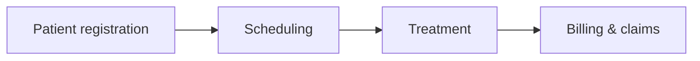

| Sub-system | Testing focus |
|---|---|
| **Provider system** | Doctor/hospital records, login and role-based access, invalid credentials, claim status |
| **Broker / agent system** | Agent details, agency–agent relationships, cashless vs reimbursement flows |
| **Patient system** | Registration, edit/view records, premium billing and payment, dependents |
| **Claim system** | Claim routing (cashless/reimbursement), validation of diagnosis/procedure codes, scheme rules |

**Cross-cutting:** data privacy and audit logs, interoperability between systems (HL7/FHIR), data integrity (no wrong-patient mix-ups), high availability, safety-critical alarms and calculations (dosage), usability for clinical staff.

### 5.5 Insurance Domain

**Objective:** ensure the policy administration system handles the full value chain correctly and compliantly; a calculation defect has direct financial and legal consequences.

| Focus | Validated |
|---|---|
| **Policy issuance** | New policy creation, eligibility, document generation |
| **Premium calculation** | Risk factors (age, cover, term), taxes, rounding, riders |
| **Underwriting** | Risk-assessment rules before approval |
| **Claims processing** | Intake, validation against policy terms, fraud checks, approve/reject, payout |
| **Renewal, grace period and lapse** | Due dates, grace rules, reinstatement |
| **Regulatory compliance** | Statutory report formats; regulator rules (IRDAI in India) |
| **Agent/broker management** | Commission calculation, agent–policy mapping |

### 5.6 Telecom Domain

**Objective:** validate subscriber provisioning, call/data routing and billing at very large transaction volumes and high availability.

| Focus | Validated |
|---|---|
| **Provisioning / activation** | SIM/number allocation, plan assignment, number portability |
| **Call and session setup** | Call establishment, routing, handover between cells, drop rate, VoLTE/IMS |
| **Billing and rating/charging** | Charge computation per plan (voice/data/SMS); real-time prepaid deduction; CDR (Call Detail Record) accuracy; invoice generation |
| **Network performance** | Latency, throughput, congestion at peak load, QoS |
| **Interoperability / roaming** | Cross-operator flows; protocols (SS7, Diameter, SIP/IMS) |
| **Value-added services (VAS)** | Caller tunes, SMS packs, data top-ups integrated with billing |
| **OSS/BSS integration** | Operations/business support systems: CRM, mediation, order management |

### 5.7 Domain Testing Template
For any new domain, answer: (1) Who are the stakeholders? (2) What are the critical workflows and business rules? (3) Which **regulations/standards** apply? (4) What are the highest **risks** (safety, money, privacy)? (5) What non-functional qualities dominate (performance, security, availability)? (6) Which **integrations** exist? Then derive tests using Unit IV techniques.

### Exam Focus: Unit V
- Web testing areas with an example for each.
- Why domain knowledge matters; banking-specific test concerns (ACID, security, concurrency).
- Compare healthcare and insurance testing.
- E-commerce test types (order processing, session, internationalization).
- Telecom billing/rating testing.

---

## Quick Revision Sheet

**Unit I**
- Testing = static + dynamic evaluation to find defects and check fitness for purpose; debugging = finding and fixing the cause.
- Verification (build it right, static) vs validation (build the right thing, dynamic).
- Error → defect → failure. Severity = technical impact; priority = business urgency.
- 7 principles: presence not absence · exhaustive impossible · early testing · clustering (80/20) · pesticide paradox · context-dependent · absence-of-errors fallacy.
- STLC: requirement analysis → planning → case development → environment setup → execution → closure.
- Bug life cycle: New → Assigned → Open → Fixed → Retest → Verified → Closed (side exits: Reopened, Rejected, Duplicate, Deferred).
- Metrics: coverage, pass rate, defect density, DRE, leakage.

**Unit II**
- Classify along axes: approach, knowledge, level, objective.
- V-model: unit ↔ LLD, integration ↔ HLD, system ↔ SRS, acceptance ↔ BRS/user needs.
- Integration: top-down (stubs), bottom-up (drivers), big-bang, sandwich.
- Non-functional: performance (load, stress, spike, soak), usability, compatibility, security, reliability.
- Regression (did we break anything?) vs re-testing (is the fix good?); smoke (is the build testable?) vs sanity (is the fix sensible?).
- Automate repetitive, stable, data-heavy tests; keep exploratory/usability manual.

**Unit III**
- Test case fields: ID, description, pre-condition, steps, data, expected, actual, status, post-condition.
- Policy → strategy → plan is a scope hierarchy; RTM proves coverage and supports impact analysis.
- BRS (business need) · SRS (technical requirements) · FDD (how it works).
- Test data: valid, boundary, invalid; mask production data.
- TCMT: Jira, TestRail, Zephyr, ALM.

**Unit IV**
- Static (no execution): reviews (informal < walkthrough < technical < inspection) + static analysis.
- White-box coverage: statement < branch < condition/decision < MC/DC < multiple-condition < path; V(G) = decisions + 1.
- **BVA:** min−1, min, min+1, max−1, max, max+1. **EP:** one value per valid/invalid partition.
- **Decision table:** one test per rule (2ⁿ combinations). **State transition:** valid + invalid transitions. **Use case:** main + alternate flows.
- Experience-based: error guessing, exploratory, checklist.
- Agile: TDD (red-green-refactor), BDD (Given/When/Then), pyramid (many unit, few UI), CI/CD.
- Risk = likelihood × impact.

**Unit V**
- Web: functionality, usability, interface, database, compatibility, performance, security (OWASP).
- Banking: functionality + performance + security; ACID, PCI DSS, batch/EOD, reconciliation.
- E-commerce: cart → order → payment → tracking; session, availability, internationalization.
- Healthcare: safety-critical; HIPAA, HL7/FHIR, DICOM, ICD-10; provider, broker, patient, claim systems.
- Insurance: issuance, premium, underwriting, claims, renewal/lapse, compliance.
- Telecom: provisioning, call setup, rating/billing, network performance, interoperability, VAS.

---

## Master Comparison Table

| Pair | Key difference |
|---|---|
| Error vs defect vs failure | Human mistake vs flaw in artifact vs observed wrong behaviour |
| Verification vs validation | Right product built right (static) vs right product (dynamic) |
| QA vs QC | Process/prevention vs product/detection |
| Testing vs debugging | Expose failure vs find and fix cause |
| Severity vs priority | Impact on system vs urgency of fix |
| Static vs dynamic testing | No execution vs execution |
| White vs black vs gray box | Code-based vs behaviour-based vs partial knowledge |
| Stub vs driver | Replaces called module vs replaces calling module |
| Alpha vs beta | Internal, pre-release vs real users, external |
| Smoke vs sanity | Broad build-stability check vs narrow change check |
| Regression vs confirmation | Nothing else broke vs the fix works |
| Load vs stress vs soak | Expected load vs beyond capacity vs long duration |
| Test scenario vs test case | High-level situation vs detailed steps, data, expected result |
| Test strategy vs test plan | General approach vs project-specific plan |
| BRS vs SRS vs FDD | Business need vs technical requirement vs operational design |
| EP vs BVA | One value per class vs values at class edges |
| Walkthrough vs inspection | Author-led, informal vs formal roles, checklists, metrics |
| TDD vs BDD | Developer unit tests first vs shared business-readable scenarios |
| Statement vs branch coverage | Every line runs vs every decision outcome taken |

---

*Cross-check formulas, tool names and definitions against your syllabus and university question bank before the exam; institutional wording can differ slightly from ISTQB phrasing.*
