# Software Testing: Complete Theory Notes

> **Course:** Software Testing (M.Sc. CA) | **Paper:** 60 Marks | **Units:** 6
> **Format:** every topic is written as exam-ready points: *Definition → Key points → Diagram → Example → Advantages / Disadvantages → Comparison*.
> Topics marked **(+)** were missing or incomplete in the slides but are standard syllabus content, so they are added here.

---

## Learning Roadmap

Study in this order. Each unit builds on the one before it.

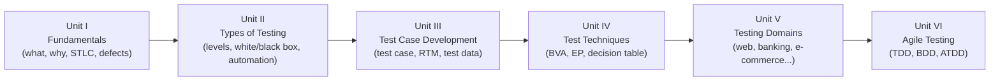

## Table of Contents

1. [Unit I: Software Testing Fundamentals](#unit-i-software-testing-fundamentals)
2. [Unit II: Types of Testing](#unit-ii-types-of-testing)
3. [Unit III: Test Case Development](#unit-iii-test-case-development)
4. [Unit IV: Testing Techniques](Software_Testing_Notes_Part2.md#unit-iv-testing-techniques)
5. [Unit V: Testing Different Domains](Software_Testing_Notes_Part2.md#unit-v-testing-different-domains)
6. [Unit VI: Understanding Agile Testing](Software_Testing_Notes_Part2.md#unit-vi-understanding-agile-testing)
7. [Short Notes (Quick Revision)](Software_Testing_Notes_Part2.md#short-notes-quick-revision)
8. [Master Comparison Sheet](Software_Testing_Notes_Part2.md#master-comparison-sheet)

**Part 2 (Units IV, V, VI, Short Notes, Master Comparison Sheet):** [https://github.com/Ajay120503/ST_Notes_Part2.git](https://github.com/Ajay120503/ST_Notes_Part2.git)

---
# Unit I: Software Testing Fundamentals

## 1.1 Basic System Concepts

Testing begins with understanding the **system** being tested.

| Term | Meaning |
|---|---|
| **System** | An orderly group of components working together to achieve a goal |
| **Sub-system / Module** | A smaller part into which a system is divided |
| **Boundary** | The limit that separates a system from the outside |
| **Environment** | Everything outside the system boundary that interacts with it |
| **Feedback** | Output/response returned to control or improve the system |
| **Organization** | A rational group of people working together for a specific goal |

**Example: Hospital Management System (module structure / functional decomposition)**

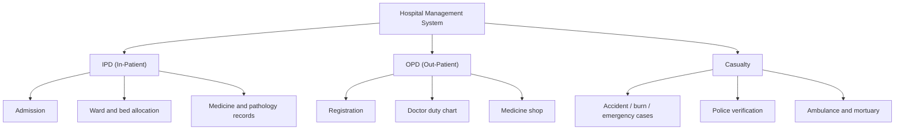

**Functional decomposition steps (points):**
1. Decide the system and its sub-systems.
2. Decide the menus / modules under each sub-system.
3. Decide the DFD level.
4. Each module normally supports **Add, Edit, View, Delete**; each becomes a test target.

**Stakeholders (people affected by the system):**

| System | Stakeholders |
|---|---|
| Payroll System | Employees, accountant, cashier, principal/manager, income-tax personnel |
| Hospital Management | Patients, doctors, nurses, ward boys, police, ambulance drivers, support staff |
| Railway Reservation | Passengers, ticket-counter clerks, train conductor, technicians, government |

---

## 1.2 Software Development Life Cycle (SDLC)

**Definition:** SDLC is a conceptual framework describing **all activities of a software project from planning to maintenance**.

**Why SDLC is needed (points):**
1. Pinpoints problems early.
2. Helps set correct system goals.
3. Determines the system boundaries.
4. Identifies limitations of available resources.

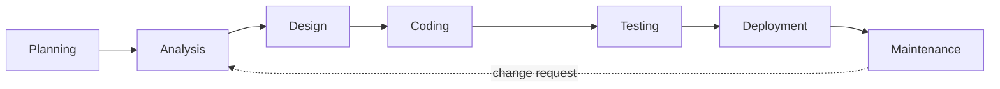

### Object-Oriented SDLC (OOSDLC)
- Built around **objects, actors and use cases** instead of functions.
- Phases: object-oriented analysis → object-oriented design → OO programming (construction) → object-oriented testing → usability/QA tests.
- **Advantages:**
  1. Handles more challenging problems.
  2. Better communication among users, analysts, designers, programmers.
  3. Consistent analysis, design and programming.
  4. Reusable analysis, design and code.

---

## 1.3 Software Process Models

**Definition:** A process model is a **standard format for planning, organizing and running** a development project: a simplified representation of the software process.

### A. Waterfall Model
- Proposed by **Winston Royce**; **linear and sequential**. Next phase starts only after the previous one is complete.
- All activities are planned and scheduled **before** work starts.

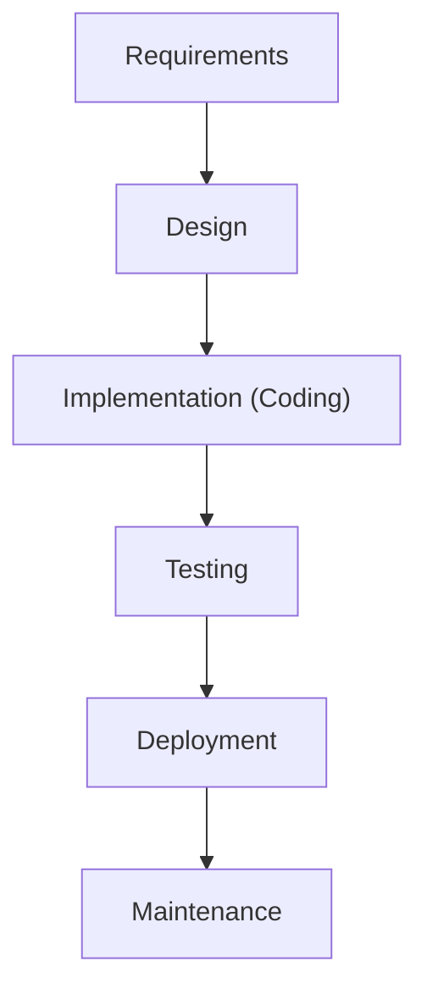

| Use when | Advantages | Disadvantages |
|---|---|---|
| Requirements are clear and **do not change** | Simple, minimal resources | Cannot accept requirement changes |
| Project is short, technology is stable | Fixed start/end per phase = easy progress tracking | Hard to go back to an earlier phase |
| Resources are available | Release date and cost known early | Testing happens late, so risks are found late |
| | Strict documentation gives customer clarity | High risk for large/complex projects |

### B. Prototyping Model
- Developer builds a **working model (prototype)**, the customer evaluates it, and it is **refined until accepted**.

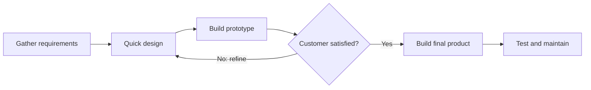

| Use when | Advantages | Disadvantages |
|---|---|---|
| Requirements are hard to specify upfront | Reduces risk of wrong requirements | Needs heavy customer collaboration |
| Requirements change often | Errors detected early | Prototyping tools can be expensive |
| Totally new system | Lower maintenance cost | Time-consuming |

### C. Incremental Model
- Combination of **waterfall + prototype**. Product is built, tested and delivered **in increments** until all requirements are met.
- Each increment goes through: planning → analysis → modelling → construction → deployment.

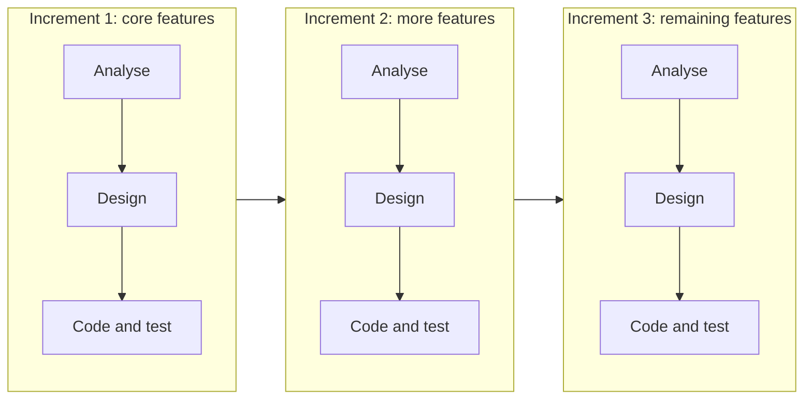

- **Use when:** customer wants quick release; schedule is long; team is not highly skilled; high-priority requirements can be built first.
- **Advantages:** saves time; customer satisfaction is visible during development.
- **Disadvantages:** many versions are built, so choosing the best one is hard; a quick version may not satisfy all needs.

### D. Spiral Model (+)
- **Risk-driven**, iterative. Each loop of the spiral has four activities: **Planning → Risk analysis → Engineering → Evaluation**.

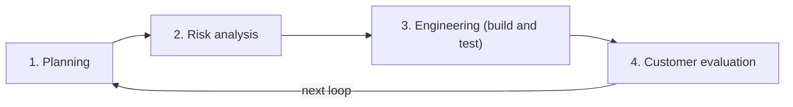

- **Best for:** large, high-risk projects. **Drawback:** needs risk-analysis expertise; costly.

### E. Agile Process Model (introduction; full detail in Unit VI)
- Iterative development in **short time-boxes (1 to 4 weeks)**; each iteration runs a full mini-SDLC and demonstrates a working product.
- **Welcomes requirement changes** at any time; minimal planning; rapid customer satisfaction.
- Methods: Scrum, XP, Crystal, FDD, DSDM, RUP. Agile Manifesto published **2001**.

### Comparative Study of Process Models

| Criteria | Waterfall | Prototype | Incremental | Spiral (+) | Agile |
|---|---|---|---|---|---|
| Flow | Linear | Build, evaluate, refine | Increment by increment | Loops with risk analysis | Short iterations |
| Requirements | Fixed | Unclear / evolving | Prioritised, partly known | Evolving | Change welcomed |
| Customer involvement | Low | Very high | Medium | Medium | Continuous |
| Risk handling | Poor | Good | Good | **Best** | Good |
| Testing time | End of project | Early (on prototype) | Each increment | Each loop | **Every sprint** |
| Best suited for | Small, stable projects | New / unclear systems | Quick partial delivery | Large, risky projects | Changing requirements |

---

## 1.4 Introduction to Software Testing

### Error, Defect, Failure

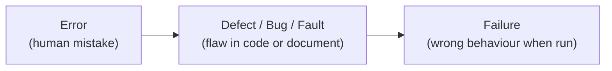

| Term | Meaning | Example |
|---|---|---|
| **Error / Mistake** | Human action producing a wrong result | Developer writes `a+b/2` |
| **Defect / Bug / Fault** | Flaw in the work product caused by an error | Formula in code is wrong |
| **Failure** | Actual result differs from expected during execution | Average of 4 and 6 shows 7 instead of 5 |

### What is Testing? (definitions: write any two)
1. A **systematic process of executing a program/system with the intent of finding errors**.
2. Evaluating a system or its components to check whether it **satisfies the specified requirements**.
3. A life-cycle activity (**static and dynamic**) covering planning, preparation and evaluation to show the product is **fit for purpose** and to detect defects.

### Purpose of Software Testing
1. Analyse an item (hardware, software, process) of the product.
2. Find the **difference between required and actual behaviour**.
3. Evaluate features and functions against **user needs**.
4. Detect and prevent all factors that lead to system failure.

### What testing checks
- Does the software respond correctly to **all kinds of inputs**?
- Is it **usable**, does it meet **all requirements** and **stakeholder needs**?
- Does it **install and run** properly in the intended environment?

### Advantages of Software Testing
1. Ensures software matches user requirements.
2. Finds and removes errors.
3. Improves quality by removing defects.
4. Removes errors that would cause failure.
5. Ensures business and user needs are fulfilled.

### Verification vs Validation

| Criteria | Verification | Validation |
|---|---|---|
| Question | "Are we building the product **right**?" | "Are we building the **right** product?" |
| Checks | Documents, design, code | Actual working software |
| Method | **Static** (reviews, walkthroughs, inspections) | **Dynamic** (execution) |
| Done by | Reviewers, QA team | Testers, users |
| Timing | Before / during development | After the build is ready |
| Example | Reviewing the SRS | Running the login screen |

### QA vs QC vs Testing (+)

| | Quality Assurance (QA) | Quality Control (QC) | Testing |
|---|---|---|---|
| Focus | **Process** (prevent defects) | **Product** (detect defects) | Executing software to find bugs |
| Nature | Proactive | Reactive | Part of QC |
| Example | Defining standards, audits | Inspecting the final build | Running test cases |

---

## 1.5 Goals of Software Testing

| Level | Goals |
|---|---|
| **Immediate** | Bug discovery; bug prevention |
| **Long-term** | Reliability; quality; customer satisfaction; risk management (failure) |
| **Post-implementation** | Reduce maintenance cost; improve the testing process |

> Defects found **after release are costlier** to fix and harder to trace.

---

## 1.6 Seven Principles of Software Testing

| # | Principle | Meaning | Example |
|---|---|---|---|
| 1 | **Testing shows presence of defects** | Testing can reveal bugs but never prove there are none | 100 tests pass, a bug can still exist |
| 2 | **Exhaustive testing is impossible** | Testing all inputs and paths is not feasible; use risk and priority | A 10-digit field has 10 billion inputs |
| 3 | **Early testing** | Start in requirement phase; saves time and money | Fixing a wrong requirement in SRS vs after release |
| 4 | **Defect clustering** | A few modules hold most defects (**Pareto 80/20**) | 80% bugs from 20% modules, e.g. payment module |
| 5 | **Pesticide paradox** | Same tests repeated stop finding new bugs; **review and update tests** | Rewrite old regression tests |
| 6 | **Testing is context dependent** | Test approach depends on the application | Banking (security) vs game (graphics) |
| 7 | **Absence-of-errors fallacy** | Bug-free software is useless if it does not meet user needs | A perfect app nobody asked for |

**Extra principles from the slides:** plan before testing; start small (unit) then grow to large (system); testing can be done by a third party; all tests must be traceable to user requirements.

---

## 1.7 Testing Roles in a Company

| Role | Responsibility |
|---|---|
| **Test Lead / Manager** | Leads the team; implements the test process |
| **Test Architect** | Integrated test architecture; estimates; reusable test assets |
| **Test Designer / Tester** | Designs and executes test cases, records results, reports defects, analyses coverage |
| **Test Automation Engineer** | Writes automation scripts; maintains automation framework |
| **Test Methodologist** | Improves quality continuously; provides strategy, framework and templates |
| **Software Tester** | Finds defects early and ensures they get fixed |

---

## 1.8 Software Testing Life Cycle (STLC)

**Definition:** STLC is a **systematic, planned and sequential** testing process (6 phases) used to improve software quality.

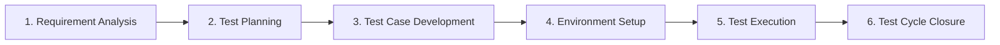

| Phase | Activities (points) | Output |
|---|---|---|
| **1. Requirement Analysis** | Identify test environment and **types of tests**; gather testing priorities; prepare **RTM**; validate requirements | RTM, feasibility report |
| **2. Test Planning** | Prepare test plan; **tool selection**; effort estimation; resource planning; roles and responsibilities; training needs | Test plan, effort estimate |
| **3. Test Case Development** | Create and review test cases; create **automation scripts**; create **test data** | Test cases, scripts, test data |
| **4. Environment Setup** | Understand architecture; list hardware/software needs; set up environment and data; run **smoke test** on the build | Ready environment, smoke result |
| **5. Test Execution** | Execute as per plan; record results; **log defects** for failures; map defects to test cases in RTM; **retest** fixes; track to closure | Execution report, defect reports |
| **6. Test Cycle Closure** | Check exit criteria (time, coverage, cost, quality); prepare test metrics; document lessons learnt; **test closure report**; result analysis | Closure report, metrics |

> **Smoke test:** quick check that the build is stable enough for detailed testing.

---

## 1.9 Defects

**Definition:** A defect is an **imperfection or deficiency in a work product** so that it does not meet the user's requirement or specification. A defect arises when the **expected result does not match the actual result**.

### Types of Defects

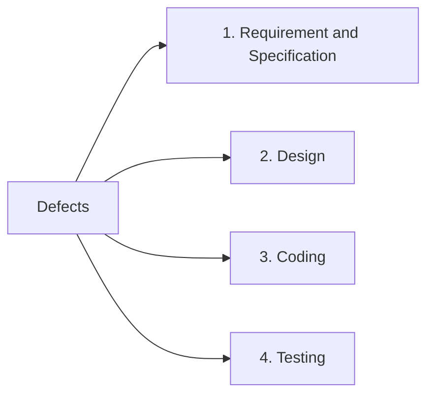

| Type | Sub-types | Example |
|---|---|---|
| **1. Requirement / Specification** (documents are in natural language: ambiguous, contradictory, redundant, imprecise) | Functional description (input/output incorrect or ambiguous); **feature** (performance/reliability missing); **feature interaction** (how features interact is wrong); **interface description** (how software connects to hardware/software/user) | SRS says "system must be fast" with no number |
| **2. Design** (component, interaction or interface designed wrongly) | **Algorithmic/processing** (wrong pseudocode); **control, logic, sequence** (wrong branching, wrong function-call order); **data** (wrong data structure/field size); **module interface** (wrong number/type of parameters); functional description; **external interface** (missing commands, no feedback messages) | Average designed as `a+b/2` instead of `(a+b)/2` |
| **3. Coding** (error in code or misuse of language constructs) | Algorithmic (sign errors, overflow, wrong parentheses, wrong data type compare); control/logic (wrong case, missing paths, wrong loop count); **typographical/syntax**; **initialization** (variable not initialised); data flow; module interface; code documentation; external hardware/software interface (DB link, system call, exception handling) | Loop runs `n+1` times; variable used before initialisation |
| **4. Testing** (defect in test artefacts) | **Test harness** defects (error in scaffolding/driver/stub code); **test case design and procedure** defects (incomplete, incorrect, missing cases) | Test case missing the invalid-input scenario |

### Severity vs Priority (+)

| | Severity | Priority |
|---|---|---|
| Meaning | **Impact** of the defect on the system | **Urgency** of fixing it |
| Set by | Tester | Product owner / manager |
| Example (high severity, low priority) | Crash in a rarely used report | |
| Example (low severity, high priority) | Company name misspelled on home page | |

---

## 1.10 Defect Management Process

**Definition:** A method of **identifying, recording, tracking and resolving defects**. Its purpose is to give information that **improves the development process** and makes software more effective and efficient.

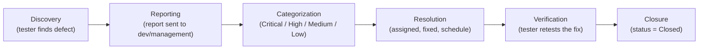

**Points:**
1. **Discovery:** defect is found and recorded.
2. **Reporting:** test manager sends the defect report to the development team for feedback; the status changes to *Accepted* if valid.
3. **Categorization:** developer **prioritises** by severity: Critical, High, Medium, Low.
4. **Resolution:** defect is assigned to a developer, a fix schedule is set, the fix is made, and reported back to the test manager.
5. **Verification:** tester verifies the defect is **actually resolved**.
6. **Closure:** once verified, the status is changed to **Closed**.

## 1.11 Defect / Bug Life Cycle

**Definition:** The journey of a defect through its entire lifetime. It varies by organisation, project and tool.

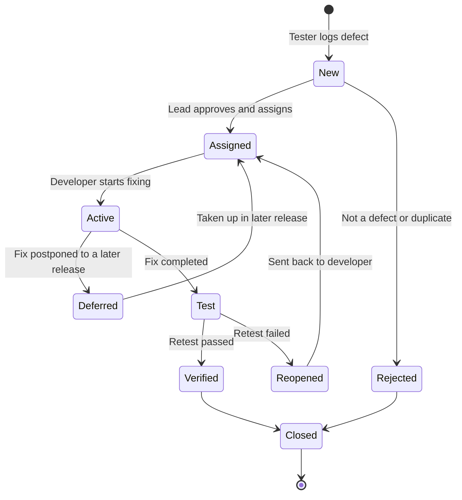

| State | Meaning |
|---|---|
| **New** | Potential defect, not yet validated |
| **Assigned** | Given to the development team to address |
| **Active (Open)** | Defect is being worked on |
| **Rejected** | Not a defect, duplicate or non-reproducible |
| **Deferred** | Cannot be fixed now; postponed to a future release |
| **Test** | Fixed and ready for retest by QA |
| **Verified** | QA retested and the fix works |
| **Reopened** | Fix failed on retest; reactivated |
| **Closed** | Final state: verified, or rejected/duplicate |

**Example (login bug):** Tester logs "Login fails with valid password" → *New* → lead assigns → *Assigned* → developer fixes → *Test* → tester retests → *Verified* → *Closed*.

---
# Unit II: Types of Testing

## 2.1 Classification of Testing

Testing is a **continuous activity** during development. It is used to **verify** (build it right) and **validate** (build the right thing).

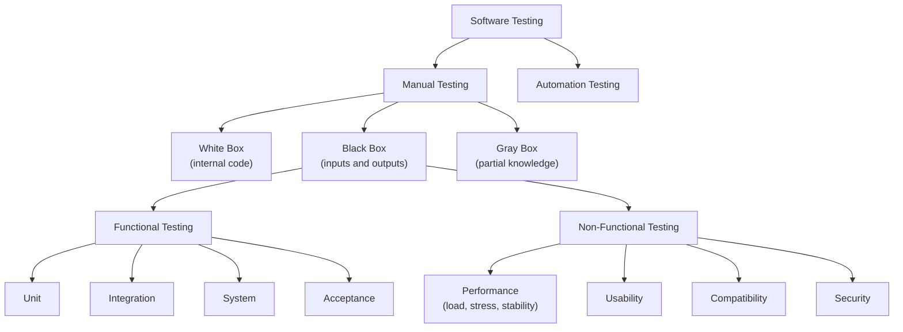

---

## 2.2 Manual vs Automation Testing

### Manual Testing
- Test cases are executed **by a human tester without any automation tool**.
- Based on the **end-user perspective**; finds visible and hidden defects.
- **Mandatory for newly developed software** before automation is considered.
- Needs great effort and time. *Example tool:* **Testpad** (simple checklist-style test planning).

### Automation Testing
- A **special software (tool/script)** controls test execution and **compares actual vs expected outcomes** automatically.
- Used for complex or repetitive tests that are hard to do manually. *Example tools:* **Selenium, QTP/UFT**.

**Benefits of automation (points):**
1. Reduces time to market; faster execution.
2. Avoids human errors.
3. Tests can **run overnight**; allows frequent releases.
4. Improves reliability and consistency.
5. Immediate testing without waiting for test engineers.

### Comparative Study

| Criteria | Manual Testing | Automation Testing |
|---|---|---|
| Execution | By human, step by step | By tool/script |
| Accuracy | Less accurate; error-prone for repeated tasks | Highly reliable for repetitive tasks |
| Time | Slow | Fast |
| Initial cost | **Low** | **High** (tool licence, setup) |
| Investment in | Human resources | Tools and scripting skill |
| Best used when | Test case runs **once or twice** | Test case runs **repeatedly** |
| UI / usability testing | **Highly effective** (human judgement) | Not effective |
| Build verification (smoke) | Not recommended | **Highly recommended** |
| Regression testing | Tiring | Ideal |
| Example | Checking look and feel of a page | 500 login test data sets via Selenium |

### Popular Automation Tools (comparison)

| Tool | Type / Key feature | Platforms |
|---|---|---|
| **Selenium** | Open source; record/playback (IDE); scripts in Java, Python, C#, Ruby; works with JUnit/TestNG; identifies elements by id, name, XPath | Web, regression testing |
| **Ranorex Studio** | Codeless + full IDE; integrates with Jira, Git, Jenkins | Desktop, web, mobile, SAP/legacy |
| **Kobiton** | Real-device cloud; converts manual sessions into scripts; supports Appium, Espresso, XCTest | Mobile |
| **LambdaTest** | Cloud Selenium grid; parallel execution on 2000+ browser/OS combinations | Cross-browser |
| **Avo Assure** | 100% no-code; 1500+ keywords; integrates with Jira, Jenkins | Web, mobile, ERP, mainframe |
| **testRigor** | Tests written in **plain English**; free public version | Web, mobile, API |
| **Subject7** | Cloud, true codeless; functional, regression, API, load, security tests | Multi-platform |

---

## 2.3 Levels of Testing

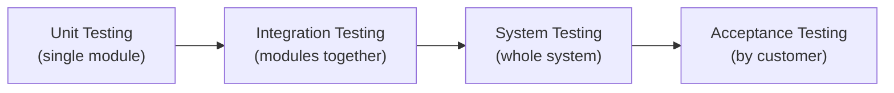

### V-Model: Development phase mapped to Testing level

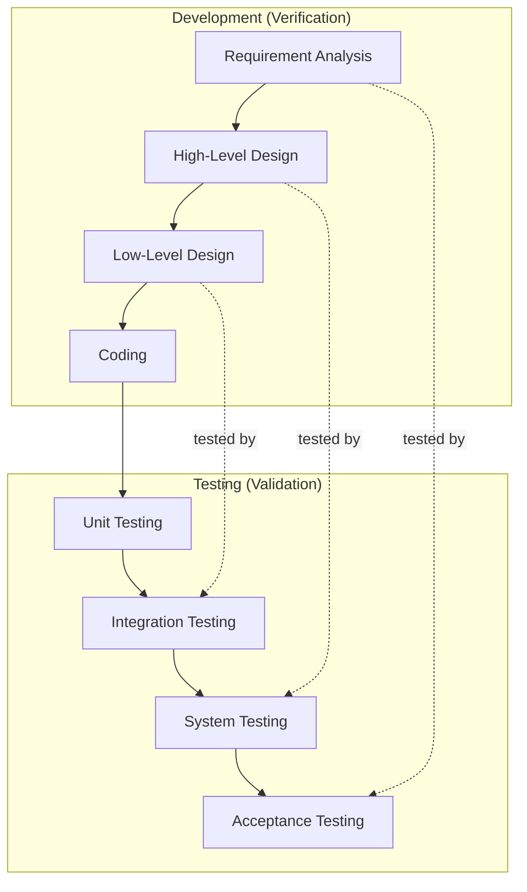

### A. Unit Testing
- **Definition:** Testing of the **smallest individual units** (function, procedure, module, statement) in isolation.
- **Done by:** Developer, **during development**.
- **Objectives:** isolate a section of code; verify correctness; test every function/procedure; fix bugs early at low cost; support code reuse.
- **Workflow:** Create test case → Review test case → Baseline → Execute test case.
- **Tools:** JUnit, NUnit, PHPUnit, Jtest, EMMA (coverage). For JavaScript/MERN: Jest, Mocha (+).
- **Example:** Function `add(a,b)` tested with `add(2,3)` expecting `5`.

| Advantages | Disadvantages |
|---|---|
| Understand functionality of each unit | Writing unit tests is time-consuming |
| Programmer can refine code with confidence | Cannot find all errors (integration/system errors missed) |
| Bugs fixed early = cheap | More maintenance effort |
| Supports reuse | Non-functional testing not covered; shows presence, not absence, of errors |

### B. Integration Testing
- **Definition:** Individually tested units are **combined and tested as a group** to find **interface errors** between modules. Results are documented.
- Approaches: **Top-down** and **Bottom-up** (also Big-bang and Sandwich (+)).

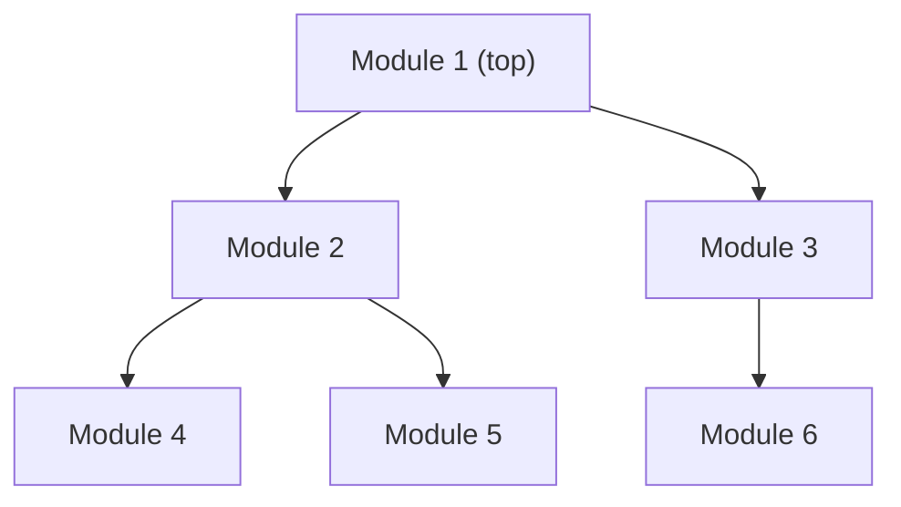

| Criteria | Top-Down | Bottom-Up |
|---|---|---|
| Starts from | Top module (M1) moving down | Lowest modules (M4, M5, M6) moving up |
| Needs | **Stubs** (dummy lower modules) | **Drivers** (dummy calling modules) |
| Advantage | Major design flaws found early | Low-level modules tested thoroughly |
| Disadvantage | Lower modules tested late | Top-level logic tested late |

| Advantages | Disadvantages |
|---|---|
| Efficient for small systems | May delay testing-team execution |
| Interfaces checked thoroughly | Interfaces may be missed when many modules exist |
| Easy to locate and fix errors | |

### C. System Testing
- **Definition:** The **complete, integrated software** is tested to check it meets all user requirements (functional) and non-functional needs (accuracy, reliability, speed as per **SRS**).
- Done from the **user's view** by a **independent test team**.
- **Advantages:** clearly specifies how the application should behave; finds bugs before production; increases efficiency.
- **Disadvantages:** redundant testing; logical errors may be missed.

### D. Acceptance Testing (UAT)
- **Definition:** Performed by the **customer/end user** to certify the system meets agreed requirements before accepting it.
- **Types (+):** **Alpha** (at developer site) and **Beta** (at user site, real environment).
- **Advantages:** software meets user needs before acceptance; simple to run; customer and developer resolve issues together; reduces chance of failure.
- **Disadvantages:** feedback may come from non-technical users; user may not be a professional tester.

### Comparison of Testing Levels

| Criteria | Unit | Integration | System | Acceptance |
|---|---|---|---|---|
| Scope | Single module | Group of modules | Whole system | Whole system in business context |
| Performed by | Developer | Developer / tester | Independent testers | Customer / end user |
| Based on | Low-level design | High-level design | SRS | User requirements |
| Focus | Code correctness | **Interfaces** | Functional + non-functional | **Business readiness** |
| Technique | White box | White + black box | Black box | Black box |
| Example | Test `calculateTax()` | Login module + dashboard | Full online shopping flow | Client approves the app before go-live |

---

## 2.4 White Box vs Black Box vs Gray Box Testing

### White Box Testing
- Also called **Structural / Glass-box / Clear-box / Transparent-box** testing.
- Test cases are designed from the **internal structure and code**: statements, conditions, branches, paths.
- **Done at unit level**; needs programming skill.
- **Why use it:** find internal security holes; check inputs inside code; check loops and conditions; test each function/object/statement.
- **Advantages:** removes extra code (optimises); easy to automate; can start early in SDLC.
- **Disadvantages:** time-consuming; expensive and complex; needs special tools (code analyzers/debuggers).

### Black Box Testing
- Also called **Behavioural / Specification-based / Input-output** testing.
- Tests based on **requirements and functionality**; internal design is **not considered**.
- **Finds:** incorrect or missing functions, interface errors, behaviour errors, data-structure errors, initialisation errors.
- **Example:** A tester who does not know the website's code tests it using a browser and clicks.
- **Advantages:** efficient on large systems; unbiased; non-technical tester can do it; user's point of view.
- **Disadvantages:** hard to design without specifications; tricky inputs are difficult to identify; may repeat tests already done by the programmer.

### Gray Box Testing (+)
- **Combination** of white and black box: tester knows **partial internal details** (e.g. DB structure, APIs) but tests from outside.
- **Example:** Testing a web page while knowing the database table structure.

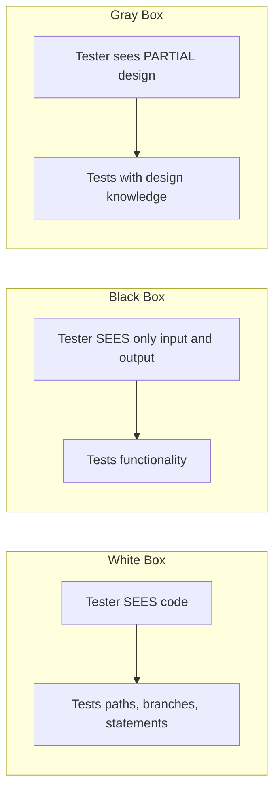

| Criteria | White Box | Black Box | Gray Box (+) |
|---|---|---|---|
| Knowledge of code | Full | None | Partial |
| Also called | Structural, glass-box | Behavioural, specification-based | Translucent |
| Tester | Developer | Tester / end user | Tester with technical knowledge |
| Level | Unit | System, acceptance | Integration |
| Basis | Code, design | Requirements (SRS) | Requirements + partial design |
| Techniques | Statement, branch, path coverage | BVA, equivalence partitioning, decision table | Matrix, pattern, regression |
| Programming skill | Required | Not required | Helpful |
| Time | More | Less | Medium |

---

## 2.5 Functional vs Non-Functional Testing

- **Functional:** checks **what** the system does (features). *Example:* Is login successful?
- **Non-Functional:** checks **how well** it works (performance, usability etc.) and readiness on parameters that functional testing cannot address. *Example:* How many users can log in at the same time?

| Criteria | Functional | Non-Functional |
|---|---|---|
| Checks | Features / business requirements | Performance, usability, security, compatibility |
| Based on | Functional requirements | Non-functional requirements (SRS) |
| Types | Unit, integration, system, acceptance | Load, stress, usability, compatibility, security |
| Example | Submit button saves record | Page loads in under 3 seconds |

### Performance Testing
- **Definition:** Checks whether the system works well under **heavy load**, measuring factors that determine overall performance.
- **Three parameters:** **Stability** (how long the system avoids failure), **Speed** (response time), **Scalability** (ability to handle growing load).
- **Advantages:** checks reliability; compares systems; evaluates overall performance.

| Type | Purpose | Example |
|---|---|---|
| **Load testing** | Behaviour under **normal and expected peak** load | 1,000 users on shopping site |
| **Stress testing** | Push **beyond limits** to find the breaking point and recovery | 10,000 users on a 1,000-user server |
| **Stability (endurance) testing** | Behaviour over a **long period** | Run for 72 hours; check memory leaks |

### Other non-functional types
- **Usability testing:** ease of use and navigation (menus, buttons, content).
- **Compatibility testing:** works across browsers, operating systems and devices.
- **Security testing:** unauthorised access, data protection, session handling.

---

## 2.6 Regression Testing

**Definition:** Re-executing a **full or partial set of already executed test cases** to confirm that a **recent code change has not broken existing functionality**.

**Why needed (points):**
1. Code changes may have **side effects** on working features.
2. Confirms old code still works after new changes.

**When to run (points):**
1. New requirement added to an existing feature.
2. New feature added.
3. Defects fixed in code.
4. Code optimised for performance.
5. Patches applied.
6. Configuration changed.

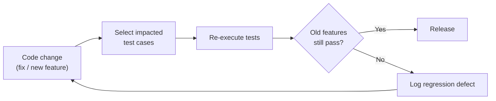

**Example:** After adding a "Pay by UPI" option, the tester re-runs the existing "Pay by Credit Card" and "Pay by Debit Card" tests.

| Criteria | Retesting | Regression Testing |
|---|---|---|
| Purpose | Confirm a **specific failed defect is fixed** | Confirm **other features are not broken** |
| Test cases | Same failed test cases | Already-passed test cases |
| Defect-based? | Yes | No |
| Automation | Hard to automate | **Best automated** |
| Priority | Done before regression | Done after retesting |

| Criteria (+) | Smoke Testing | Sanity Testing | Regression Testing |
|---|---|---|---|
| Purpose | Is the **build stable** enough to test? | Is the **specific fix/feature** working? | Is **existing functionality** unaffected? |
| Scope | Broad, shallow | Narrow, deep | Broad, deep |
| Performed | On every new build | After minor changes | After any change |
| Scripted | Yes (can be automated) | Usually unscripted | Yes (automated) |

---
# Unit III: Test Case Development

## 3.1 Test Documentation

**Definition:** Test documentation is the set of **artefacts created before or during testing**. It helps the team estimate effort, track coverage, resources and progress, and records planning, design, execution and results. Formats: `.doc`, `.xls`, `.txt`, `.html`, `.pdf`.

### Types of Test Documents

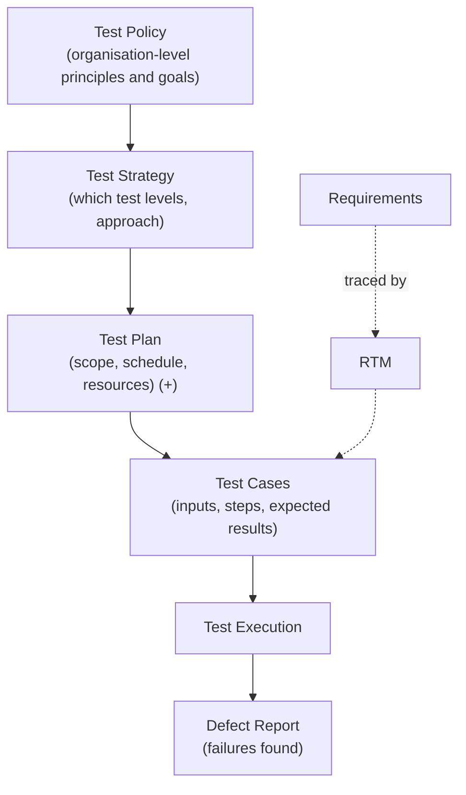

| Document | Description |
|---|---|
| **Test Policy** | High-level document: principles, methods and **testing goals of the whole organisation** |
| **Test Strategy** | High-level document: identifies **test levels** to be executed for a project |
| **Test Plan (+)** | Scope, approach, schedule, resources, risks of one project |
| **RTM** (Requirement Traceability Matrix) | **Connects requirements to test cases** |
| **Test Case** | Input values, pre-condition, steps, expected output, post-condition, result for a test scenario |
| **Defect Report** | Reports a flaw where the system fails to perform its expected function |

| Advantages | Disadvantages |
|---|---|
| Removes ambiguity while allocating tasks | Costly and time-consuming |
| Systematic approach; **training material** for freshers | Often written by people unsure what/how to write |
| Helps deliver quality product within time | Updating documents is tiring |
| Helps configuration through manuals | Poor documents make a good product look poor |
| Improves **transparency with clients** | |

---

## 3.2 Test Case

**Definition:** A test case is a **set of actions executed to verify a particular feature** of an application. It contains test steps, test data, pre-condition and post-condition to verify a requirement.

> **Real-life analogy (writing a letter):** Pre-condition = *must have a pen with refill*; Steps = *find pen, check refill, write letter*; Expected = *letter is written*; Post-condition = *letter is verified*.

### Test Case Components

| Field | Meaning |
|---|---|
| **Test Case ID** | Unique identifier (e.g. TC-01) for tracking |
| **Description / Objective** | What is being verified |
| **Pre-condition** | What must be in place **before** running (e.g. browser installed, user registered) |
| **Test Steps** | Actions performed, in order |
| **Test Data** | Input values used |
| **Expected Result** | What the system should do |
| **Actual Result** | What the system actually did (filled during execution) |
| **Status** | Pass / Fail |
| **Post-condition** | State after the test (e.g. login time saved in DB) |
| **Notes / Remarks** | Extra information |

### How to Write a Test Case (step-by-step)

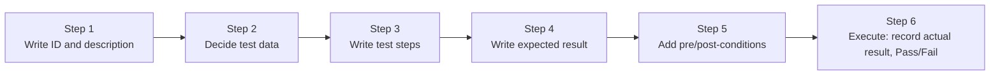

### Example 1: Login functionality (positive and negative)

| ID | Description | Pre-condition | Steps | Test Data | Expected Result | Actual Result | Status |
|---|---|---|---|---|---|---|---|
| TC-01 | Login with **valid** data | User is registered; browser open | 1. Open site 2. Enter user-id 3. Enter password 4. Click Submit | id = `kk`, pwd = `kk1` | User logs in successfully | As expected | **Pass** |
| TC-02 | Login with **invalid password** | Same | Same steps | id = `kk`, pwd = `abc` | Error message "Invalid credentials"; no login | Error shown | **Pass** |
| TC-03 | Login with **blank fields** | Same | Click Submit with empty fields | (empty) | "Fields are required" message | Page crashed | **Fail** |

**Post-condition (TC-01):** login date and time stored in the database.

### Example 2: Division by zero in Windows Calculator

| Field | Value |
|---|---|
| Test Case ID | TC-CALC-01 |
| Objective | Verify the calculator handles division by zero |
| Pre-condition | Calculator is open in Standard mode |
| Steps | 1. Enter `5` 2. Click `÷` 3. Enter `0` 4. Click `=` |
| Test Data | 5 ÷ 0 |
| Expected Result | Message "Cannot divide by zero" displayed; application does not crash |
| Post-condition | Calculator remains usable after pressing Clear |

### Points to remember while drafting
1. State the requirement being tested.
2. Explain how the system will be tested.
3. Machine configuration, OS and hardware must be set correctly.
4. Specify input, output and expected results.
5. A test case should not exceed **15 steps**.

### Best Practices for Good Test Cases
1. Keep them **simple** and clear.
2. **Avoid repetition.**
3. Keep the **end-user** in mind.
4. Do **not assume** features or functionality.
5. Ensure **100% requirement coverage**.
6. Use test-design techniques (BVA, EP: see Unit IV).
7. **Self-cleaning:** return the system to its original state.
8. **Identifiable:** unique ID helps defect tracking.
9. **Repeatable:** same result every time.
10. **Peer reviewed.**

---

## 3.3 Test Analysis

**Definition:** Checking and analysing **test artefacts (documents)** to derive test conditions and test cases. The goal is to **gather requirements and define test objectives**.

**Sources of test information:** SRS, BRS, FDD.

| Document | Full form | Description |
|---|---|---|
| **SRS** | Software Requirement Specification | **How the system should be built**; roadmap for everyone; high-level description; functional and non-functional specs; external interfaces; design constraints |
| **BRS** | Business Requirement Specification | **Formal document of client's requirements** (written and verbal); how trading partners perform roles and share duties; high-level functional specs |
| **FDD** | Functional Design Document | How a **process or system works**; no deep technical details; explains how people interact; shared with stakeholders for review and sign-off; time-consuming to maintain |

```mermaid
%%{init: {"flowchart": {"htmlLabels": false}}}%%
flowchart LR
    BRS["BRS<br/>(what the business wants)"] --> SRS["SRS<br/>(what the software must do)"] --> FDD["FDD<br/>(how it functions)"] --> TA["Test Analysis"] --> TC["Test Conditions and Test Cases"]
```

---

## 3.4 Requirement Traceability Matrix (RTM)

**Definition:** A document showing the **relationship between requirements and other artefacts** (test cases, test results, defects). It **proves that every requirement has been tested**.

**How to create RTM (3 steps):**
1. **Define your goal.**
2. **Establish artefacts and relationships** (requirement ↔ test case).
3. **Fill in the matrix** (in Microsoft Excel or any tool).

```mermaid
%%{init: {"flowchart": {"htmlLabels": false}}}%%
flowchart LR
    BR["Business Requirement"] --> FR["Functional Requirement"] --> TC["Test Case"] --> EX["Execution Result"] --> DF["Defect"]
```

**Example: Online Flight Booking**

| Business Req | Business Use Case | Functional Req | Functional Use Case | Priority | Test Case IDs |
|---|---|---|---|---|---|
| BR-1 | Reservation module | FR-1 | One-way ticket booking | High | TC001, TC002 |
| | | FR-2 | Round-trip ticket booking | Medium | TC003, TC004 |
| | | FR-3 | Multi-city booking | High | TC005, TC006 |
| BR-2 | Payment module | FR-4 | Pay by credit card | High | TC007, TC008 |
| | | FR-5 | Pay by debit card | High | TC009 |
| | | FR-6 | Pay by reward points | Low | TC010, TC011 |

**Example: Hospital Management System (two processes)**

| Req ID | Requirement | Priority | Test Cases |
|---|---|---|---|
| HMS-01 | Register a new patient | High | TC-P01 (valid data), TC-P02 (duplicate patient) |
| HMS-02 | Book doctor appointment | High | TC-A01 (free slot), TC-A02 (booked slot) |

**Advantages:** overview of all requirements; shows requirement-to-test linkage; ensures **100% coverage**; easy to prepare; no special tool needed.

**Types (+):** *Forward* (requirement → test case), *Backward* (test case → requirement), *Bi-directional* (both).

---

## 3.5 Test Data

**Definition:** The data collected and managed from various sources to **execute test cases**.

```mermaid
%%{init: {"flowchart": {"htmlLabels": false}}}%%
flowchart TD
    TD["Test Data"] --> V["Valid Data<br/>(program should accept and process)"]
    TD --> I["Invalid / Erroneous Data<br/>(program cannot process, must reject)"]
    TD --> E["Extreme / Boundary Data<br/>(at the edge of the valid range)"]
```

**Example:** Field "Age" accepts 18 to 60.

| Type | Values |
|---|---|
| Valid | 25, 40 |
| Invalid / erroneous | -5, 75, "abc", blank |
| Extreme / boundary | 17, 18, 60, 61 |

**How to create test data:**
1. **Manually**, mostly in an Excel sheet based on test scenarios and conditions (also `.doc`, `.txt`).
2. **Test data generator:** a specialised tool that generates **false (mock) data**; the simplest generator is Excel.

---

## 3.6 Test Case Management Tools (TCMT)

**Definition:** Tools that **help manage and maintain test cases**. Examples: **Jira**, **Quality Center (ALM)**, TestRail (+).

| Feature | Benefit |
|---|---|
| Documenting test cases | Templates speed up creation |
| Executing and recording results | Run test cases and store results in the tool |
| **Automated defect tracking** | Failed tests link to the bug tracker; email notification |
| **Traceability** | Requirements, test cases, execution, defects all interlinked |
| Protecting test cases | Reusable and safe from loss or corruption |

---
