# Software Testing: Complete Theory Notes

> **Course:** Software Testing (M.Sc. CA) | **Paper:** 60 Marks | **Units:** 6
> **Format:** every topic is written as exam-ready points: *Definition → Key points → Diagram → Example → Advantages / Disadvantages → Comparison*.
> Topics marked **(+)** were missing or incomplete in the slides but are standard syllabus content, so they are added here.

---

## Learning Roadmap

Study in this order. Each unit builds on the one before it.

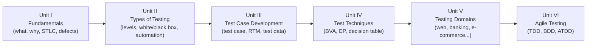

## Table of Contents

1. [Unit I: Software Testing Fundamentals](#unit-i-software-testing-fundamentals)
2. [Unit II: Types of Testing](#unit-ii-types-of-testing)
3. [Unit III: Test Case Development](#unit-iii-test-case-development)
4. [Unit IV: Testing Techniques](#unit-iv-testing-techniques)
5. [Unit V: Testing Different Domains](#unit-v-testing-different-domains)
6. [Unit VI: Understanding Agile Testing](#unit-vi-understanding-agile-testing)
7. [Short Notes (Quick Revision)](#short-notes-quick-revision)
8. [Master Comparison Sheet](#master-comparison-sheet)

---
# Unit I: Software Testing Fundamentals

## 1.1 Basic System Concepts

Testing begins with understanding the **system** being tested.

| Term | Meaning |
|---|---|
| **System** | An orderly group of components working together to achieve a goal |
| **Sub-system / Module** | A smaller part into which a system is divided |
| **Boundary** | The limit that separates a system from the outside |
| **Environment** | Everything outside the system boundary that interacts with it |
| **Feedback** | Output/response returned to control or improve the system |
| **Organization** | A rational group of people working together for a specific goal |

**Example: Hospital Management System (module structure / functional decomposition)**

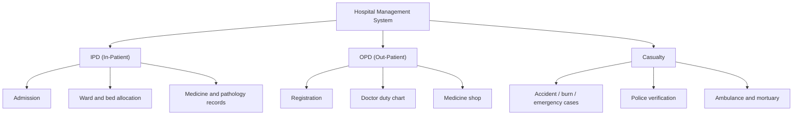

**Functional decomposition steps (points):**
1. Decide the system and its sub-systems.
2. Decide the menus / modules under each sub-system.
3. Decide the DFD level.
4. Each module normally supports **Add, Edit, View, Delete**; each becomes a test target.

**Stakeholders (people affected by the system):**

| System | Stakeholders |
|---|---|
| Payroll System | Employees, accountant, cashier, principal/manager, income-tax personnel |
| Hospital Management | Patients, doctors, nurses, ward boys, police, ambulance drivers, support staff |
| Railway Reservation | Passengers, ticket-counter clerks, train conductor, technicians, government |

---

## 1.2 Software Development Life Cycle (SDLC)

**Definition:** SDLC is a conceptual framework describing **all activities of a software project from planning to maintenance**.

**Why SDLC is needed (points):**
1. Pinpoints problems early.
2. Helps set correct system goals.
3. Determines the system boundaries.
4. Identifies limitations of available resources.

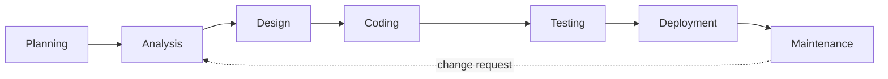

### Object-Oriented SDLC (OOSDLC)
- Built around **objects, actors and use cases** instead of functions.
- Phases: object-oriented analysis → object-oriented design → OO programming (construction) → object-oriented testing → usability/QA tests.
- **Advantages:**
  1. Handles more challenging problems.
  2. Better communication among users, analysts, designers, programmers.
  3. Consistent analysis, design and programming.
  4. Reusable analysis, design and code.

---

## 1.3 Software Process Models

**Definition:** A process model is a **standard format for planning, organizing and running** a development project: a simplified representation of the software process.

### A. Waterfall Model
- Proposed by **Winston Royce**; **linear and sequential**. Next phase starts only after the previous one is complete.
- All activities are planned and scheduled **before** work starts.

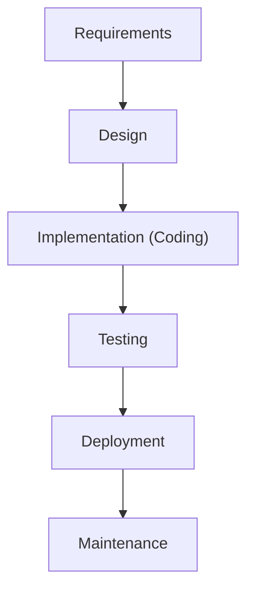

| Use when | Advantages | Disadvantages |
|---|---|---|
| Requirements are clear and **do not change** | Simple, minimal resources | Cannot accept requirement changes |
| Project is short, technology is stable | Fixed start/end per phase = easy progress tracking | Hard to go back to an earlier phase |
| Resources are available | Release date and cost known early | Testing happens late, so risks are found late |
| | Strict documentation gives customer clarity | High risk for large/complex projects |

### B. Prototyping Model
- Developer builds a **working model (prototype)**, the customer evaluates it, and it is **refined until accepted**.

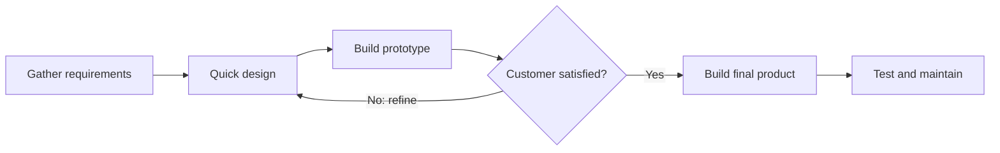

| Use when | Advantages | Disadvantages |
|---|---|---|
| Requirements are hard to specify upfront | Reduces risk of wrong requirements | Needs heavy customer collaboration |
| Requirements change often | Errors detected early | Prototyping tools can be expensive |
| Totally new system | Lower maintenance cost | Time-consuming |

### C. Incremental Model
- Combination of **waterfall + prototype**. Product is built, tested and delivered **in increments** until all requirements are met.
- Each increment goes through: planning → analysis → modelling → construction → deployment.

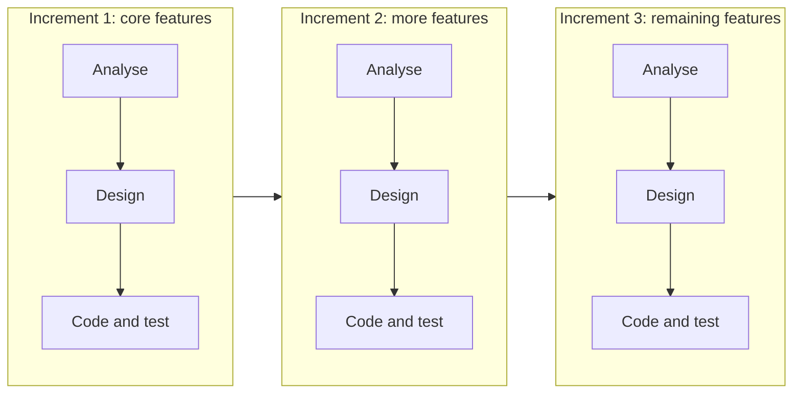

- **Use when:** customer wants quick release; schedule is long; team is not highly skilled; high-priority requirements can be built first.
- **Advantages:** saves time; customer satisfaction is visible during development.
- **Disadvantages:** many versions are built, so choosing the best one is hard; a quick version may not satisfy all needs.

### D. Spiral Model (+)
- **Risk-driven**, iterative. Each loop of the spiral has four activities: **Planning → Risk analysis → Engineering → Evaluation**.

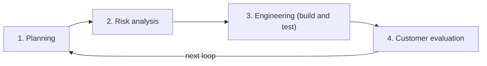

- **Best for:** large, high-risk projects. **Drawback:** needs risk-analysis expertise; costly.

### E. Agile Process Model (introduction; full detail in Unit VI)
- Iterative development in **short time-boxes (1 to 4 weeks)**; each iteration runs a full mini-SDLC and demonstrates a working product.
- **Welcomes requirement changes** at any time; minimal planning; rapid customer satisfaction.
- Methods: Scrum, XP, Crystal, FDD, DSDM, RUP. Agile Manifesto published **2001**.

### Comparative Study of Process Models

| Criteria | Waterfall | Prototype | Incremental | Spiral (+) | Agile |
|---|---|---|---|---|---|
| Flow | Linear | Build, evaluate, refine | Increment by increment | Loops with risk analysis | Short iterations |
| Requirements | Fixed | Unclear / evolving | Prioritised, partly known | Evolving | Change welcomed |
| Customer involvement | Low | Very high | Medium | Medium | Continuous |
| Risk handling | Poor | Good | Good | **Best** | Good |
| Testing time | End of project | Early (on prototype) | Each increment | Each loop | **Every sprint** |
| Best suited for | Small, stable projects | New / unclear systems | Quick partial delivery | Large, risky projects | Changing requirements |

---

## 1.4 Introduction to Software Testing

### Error, Defect, Failure

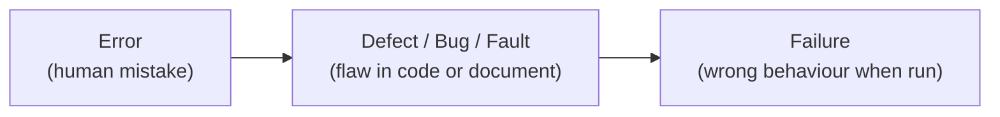

| Term | Meaning | Example |
|---|---|---|
| **Error / Mistake** | Human action producing a wrong result | Developer writes `a+b/2` |
| **Defect / Bug / Fault** | Flaw in the work product caused by an error | Formula in code is wrong |
| **Failure** | Actual result differs from expected during execution | Average of 4 and 6 shows 7 instead of 5 |

### What is Testing? (definitions: write any two)
1. A **systematic process of executing a program/system with the intent of finding errors**.
2. Evaluating a system or its components to check whether it **satisfies the specified requirements**.
3. A life-cycle activity (**static and dynamic**) covering planning, preparation and evaluation to show the product is **fit for purpose** and to detect defects.

### Purpose of Software Testing
1. Analyse an item (hardware, software, process) of the product.
2. Find the **difference between required and actual behaviour**.
3. Evaluate features and functions against **user needs**.
4. Detect and prevent all factors that lead to system failure.

### What testing checks
- Does the software respond correctly to **all kinds of inputs**?
- Is it **usable**, does it meet **all requirements** and **stakeholder needs**?
- Does it **install and run** properly in the intended environment?

### Advantages of Software Testing
1. Ensures software matches user requirements.
2. Finds and removes errors.
3. Improves quality by removing defects.
4. Removes errors that would cause failure.
5. Ensures business and user needs are fulfilled.

### Verification vs Validation

| Criteria | Verification | Validation |
|---|---|---|
| Question | "Are we building the product **right**?" | "Are we building the **right** product?" |
| Checks | Documents, design, code | Actual working software |
| Method | **Static** (reviews, walkthroughs, inspections) | **Dynamic** (execution) |
| Done by | Reviewers, QA team | Testers, users |
| Timing | Before / during development | After the build is ready |
| Example | Reviewing the SRS | Running the login screen |

### QA vs QC vs Testing (+)

| | Quality Assurance (QA) | Quality Control (QC) | Testing |
|---|---|---|---|
| Focus | **Process** (prevent defects) | **Product** (detect defects) | Executing software to find bugs |
| Nature | Proactive | Reactive | Part of QC |
| Example | Defining standards, audits | Inspecting the final build | Running test cases |

---

## 1.5 Goals of Software Testing

| Level | Goals |
|---|---|
| **Immediate** | Bug discovery; bug prevention |
| **Long-term** | Reliability; quality; customer satisfaction; risk management (failure) |
| **Post-implementation** | Reduce maintenance cost; improve the testing process |

> Defects found **after release are costlier** to fix and harder to trace.

---

## 1.6 Seven Principles of Software Testing

| # | Principle | Meaning | Example |
|---|---|---|---|
| 1 | **Testing shows presence of defects** | Testing can reveal bugs but never prove there are none | 100 tests pass, a bug can still exist |
| 2 | **Exhaustive testing is impossible** | Testing all inputs and paths is not feasible; use risk and priority | A 10-digit field has 10 billion inputs |
| 3 | **Early testing** | Start in requirement phase; saves time and money | Fixing a wrong requirement in SRS vs after release |
| 4 | **Defect clustering** | A few modules hold most defects (**Pareto 80/20**) | 80% bugs from 20% modules, e.g. payment module |
| 5 | **Pesticide paradox** | Same tests repeated stop finding new bugs; **review and update tests** | Rewrite old regression tests |
| 6 | **Testing is context dependent** | Test approach depends on the application | Banking (security) vs game (graphics) |
| 7 | **Absence-of-errors fallacy** | Bug-free software is useless if it does not meet user needs | A perfect app nobody asked for |

**Extra principles from the slides:** plan before testing; start small (unit) then grow to large (system); testing can be done by a third party; all tests must be traceable to user requirements.

---

## 1.7 Testing Roles in a Company

| Role | Responsibility |
|---|---|
| **Test Lead / Manager** | Leads the team; implements the test process |
| **Test Architect** | Integrated test architecture; estimates; reusable test assets |
| **Test Designer / Tester** | Designs and executes test cases, records results, reports defects, analyses coverage |
| **Test Automation Engineer** | Writes automation scripts; maintains automation framework |
| **Test Methodologist** | Improves quality continuously; provides strategy, framework and templates |
| **Software Tester** | Finds defects early and ensures they get fixed |

---

## 1.8 Software Testing Life Cycle (STLC)

**Definition:** STLC is a **systematic, planned and sequential** testing process (6 phases) used to improve software quality.

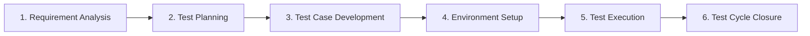

| Phase | Activities (points) | Output |
|---|---|---|
| **1. Requirement Analysis** | Identify test environment and **types of tests**; gather testing priorities; prepare **RTM**; validate requirements | RTM, feasibility report |
| **2. Test Planning** | Prepare test plan; **tool selection**; effort estimation; resource planning; roles and responsibilities; training needs | Test plan, effort estimate |
| **3. Test Case Development** | Create and review test cases; create **automation scripts**; create **test data** | Test cases, scripts, test data |
| **4. Environment Setup** | Understand architecture; list hardware/software needs; set up environment and data; run **smoke test** on the build | Ready environment, smoke result |
| **5. Test Execution** | Execute as per plan; record results; **log defects** for failures; map defects to test cases in RTM; **retest** fixes; track to closure | Execution report, defect reports |
| **6. Test Cycle Closure** | Check exit criteria (time, coverage, cost, quality); prepare test metrics; document lessons learnt; **test closure report**; result analysis | Closure report, metrics |

> **Smoke test:** quick check that the build is stable enough for detailed testing.

---

## 1.9 Defects

**Definition:** A defect is an **imperfection or deficiency in a work product** so that it does not meet the user's requirement or specification. A defect arises when the **expected result does not match the actual result**.

### Types of Defects

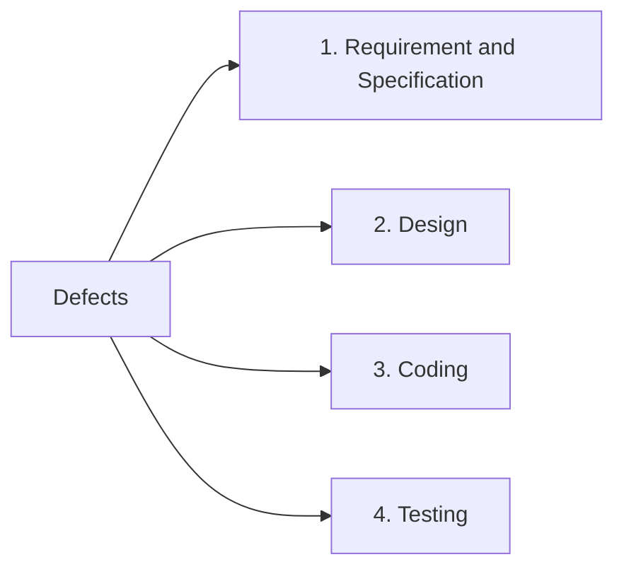

| Type | Sub-types | Example |
|---|---|---|
| **1. Requirement / Specification** (documents are in natural language: ambiguous, contradictory, redundant, imprecise) | Functional description (input/output incorrect or ambiguous); **feature** (performance/reliability missing); **feature interaction** (how features interact is wrong); **interface description** (how software connects to hardware/software/user) | SRS says "system must be fast" with no number |
| **2. Design** (component, interaction or interface designed wrongly) | **Algorithmic/processing** (wrong pseudocode); **control, logic, sequence** (wrong branching, wrong function-call order); **data** (wrong data structure/field size); **module interface** (wrong number/type of parameters); functional description; **external interface** (missing commands, no feedback messages) | Average designed as `a+b/2` instead of `(a+b)/2` |
| **3. Coding** (error in code or misuse of language constructs) | Algorithmic (sign errors, overflow, wrong parentheses, wrong data type compare); control/logic (wrong case, missing paths, wrong loop count); **typographical/syntax**; **initialization** (variable not initialised); data flow; module interface; code documentation; external hardware/software interface (DB link, system call, exception handling) | Loop runs `n+1` times; variable used before initialisation |
| **4. Testing** (defect in test artefacts) | **Test harness** defects (error in scaffolding/driver/stub code); **test case design and procedure** defects (incomplete, incorrect, missing cases) | Test case missing the invalid-input scenario |

### Severity vs Priority (+)

| | Severity | Priority |
|---|---|---|
| Meaning | **Impact** of the defect on the system | **Urgency** of fixing it |
| Set by | Tester | Product owner / manager |
| Example (high severity, low priority) | Crash in a rarely used report | |
| Example (low severity, high priority) | Company name misspelled on home page | |

---

## 1.10 Defect Management Process

**Definition:** A method of **identifying, recording, tracking and resolving defects**. Its purpose is to give information that **improves the development process** and makes software more effective and efficient.

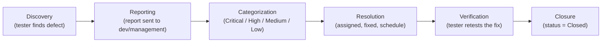

**Points:**
1. **Discovery:** defect is found and recorded.
2. **Reporting:** test manager sends the defect report to the development team for feedback; the status changes to *Accepted* if valid.
3. **Categorization:** developer **prioritises** by severity: Critical, High, Medium, Low.
4. **Resolution:** defect is assigned to a developer, a fix schedule is set, the fix is made, and reported back to the test manager.
5. **Verification:** tester verifies the defect is **actually resolved**.
6. **Closure:** once verified, the status is changed to **Closed**.

## 1.11 Defect / Bug Life Cycle

**Definition:** The journey of a defect through its entire lifetime. It varies by organisation, project and tool.

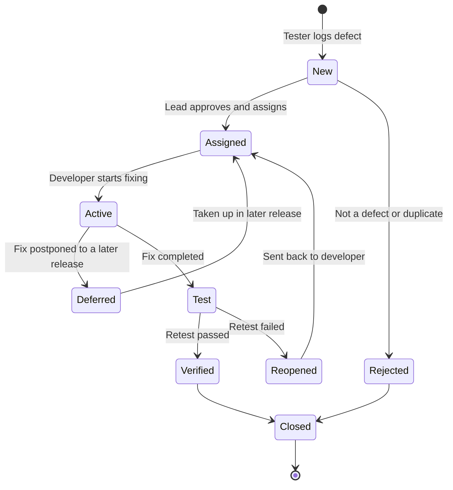

| State | Meaning |
|---|---|
| **New** | Potential defect, not yet validated |
| **Assigned** | Given to the development team to address |
| **Active (Open)** | Defect is being worked on |
| **Rejected** | Not a defect, duplicate or non-reproducible |
| **Deferred** | Cannot be fixed now; postponed to a future release |
| **Test** | Fixed and ready for retest by QA |
| **Verified** | QA retested and the fix works |
| **Reopened** | Fix failed on retest; reactivated |
| **Closed** | Final state: verified, or rejected/duplicate |

**Example (login bug):** Tester logs "Login fails with valid password" → *New* → lead assigns → *Assigned* → developer fixes → *Test* → tester retests → *Verified* → *Closed*.

---
# Unit II: Types of Testing

## 2.1 Classification of Testing

Testing is a **continuous activity** during development. It is used to **verify** (build it right) and **validate** (build the right thing).

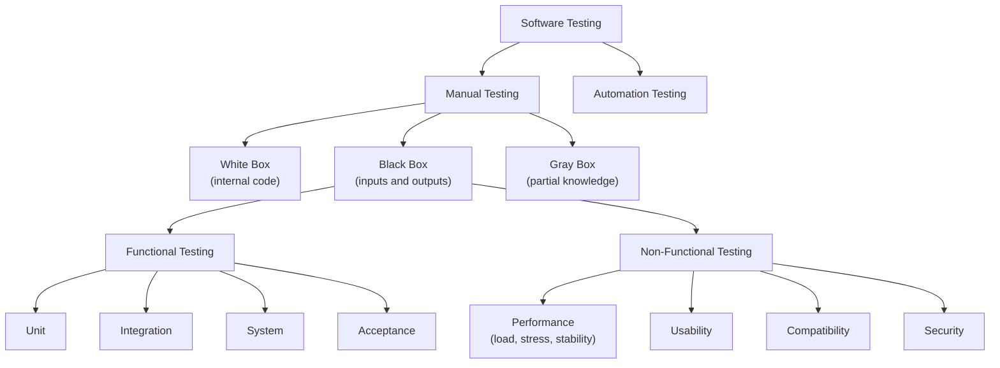

---

## 2.2 Manual vs Automation Testing

### Manual Testing
- Test cases are executed **by a human tester without any automation tool**.
- Based on the **end-user perspective**; finds visible and hidden defects.
- **Mandatory for newly developed software** before automation is considered.
- Needs great effort and time. *Example tool:* **Testpad** (simple checklist-style test planning).

### Automation Testing
- A **special software (tool/script)** controls test execution and **compares actual vs expected outcomes** automatically.
- Used for complex or repetitive tests that are hard to do manually. *Example tools:* **Selenium, QTP/UFT**.

**Benefits of automation (points):**
1. Reduces time to market; faster execution.
2. Avoids human errors.
3. Tests can **run overnight**; allows frequent releases.
4. Improves reliability and consistency.
5. Immediate testing without waiting for test engineers.

### Comparative Study

| Criteria | Manual Testing | Automation Testing |
|---|---|---|
| Execution | By human, step by step | By tool/script |
| Accuracy | Less accurate; error-prone for repeated tasks | Highly reliable for repetitive tasks |
| Time | Slow | Fast |
| Initial cost | **Low** | **High** (tool licence, setup) |
| Investment in | Human resources | Tools and scripting skill |
| Best used when | Test case runs **once or twice** | Test case runs **repeatedly** |
| UI / usability testing | **Highly effective** (human judgement) | Not effective |
| Build verification (smoke) | Not recommended | **Highly recommended** |
| Regression testing | Tiring | Ideal |
| Example | Checking look and feel of a page | 500 login test data sets via Selenium |

### Popular Automation Tools (comparison)

| Tool | Type / Key feature | Platforms |
|---|---|---|
| **Selenium** | Open source; record/playback (IDE); scripts in Java, Python, C#, Ruby; works with JUnit/TestNG; identifies elements by id, name, XPath | Web, regression testing |
| **Ranorex Studio** | Codeless + full IDE; integrates with Jira, Git, Jenkins | Desktop, web, mobile, SAP/legacy |
| **Kobiton** | Real-device cloud; converts manual sessions into scripts; supports Appium, Espresso, XCTest | Mobile |
| **LambdaTest** | Cloud Selenium grid; parallel execution on 2000+ browser/OS combinations | Cross-browser |
| **Avo Assure** | 100% no-code; 1500+ keywords; integrates with Jira, Jenkins | Web, mobile, ERP, mainframe |
| **testRigor** | Tests written in **plain English**; free public version | Web, mobile, API |
| **Subject7** | Cloud, true codeless; functional, regression, API, load, security tests | Multi-platform |

---

## 2.3 Levels of Testing

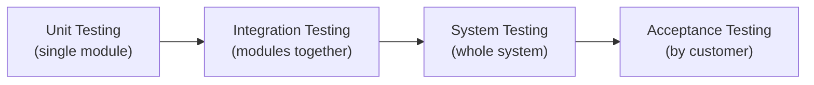

### V-Model: Development phase mapped to Testing level

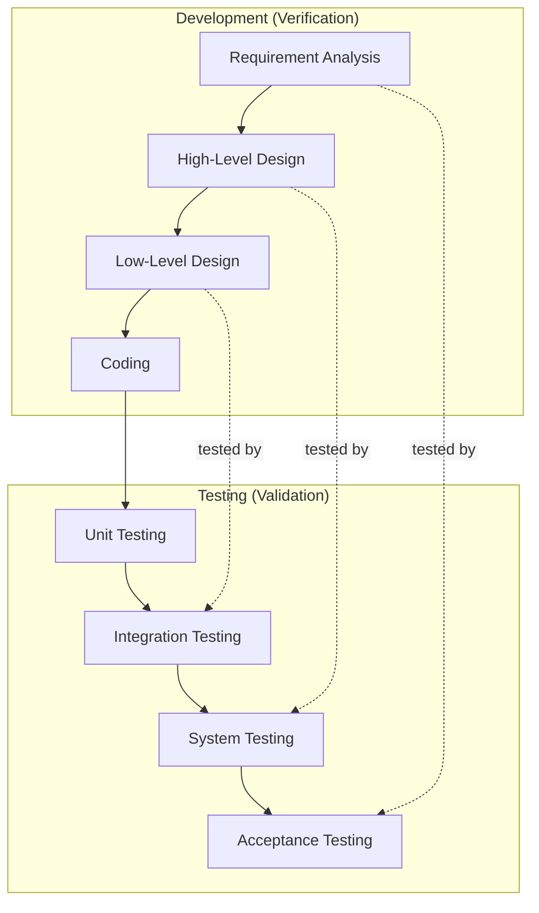

### A. Unit Testing
- **Definition:** Testing of the **smallest individual units** (function, procedure, module, statement) in isolation.
- **Done by:** Developer, **during development**.
- **Objectives:** isolate a section of code; verify correctness; test every function/procedure; fix bugs early at low cost; support code reuse.
- **Workflow:** Create test case → Review test case → Baseline → Execute test case.
- **Tools:** JUnit, NUnit, PHPUnit, Jtest, EMMA (coverage). For JavaScript/MERN: Jest, Mocha (+).
- **Example:** Function `add(a,b)` tested with `add(2,3)` expecting `5`.

| Advantages | Disadvantages |
|---|---|
| Understand functionality of each unit | Writing unit tests is time-consuming |
| Programmer can refine code with confidence | Cannot find all errors (integration/system errors missed) |
| Bugs fixed early = cheap | More maintenance effort |
| Supports reuse | Non-functional testing not covered; shows presence, not absence, of errors |

### B. Integration Testing
- **Definition:** Individually tested units are **combined and tested as a group** to find **interface errors** between modules. Results are documented.
- Approaches: **Top-down** and **Bottom-up** (also Big-bang and Sandwich (+)).

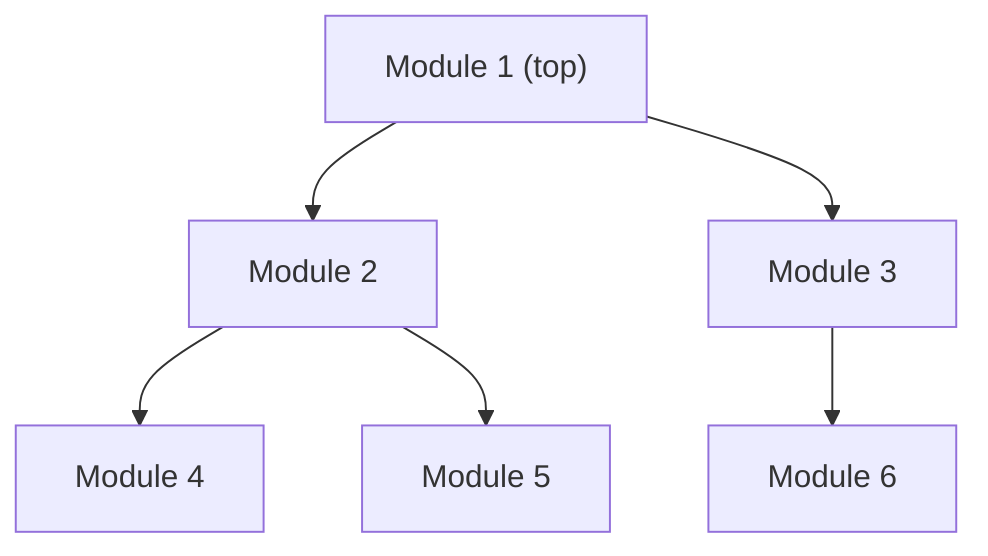

| Criteria | Top-Down | Bottom-Up |
|---|---|---|
| Starts from | Top module (M1) moving down | Lowest modules (M4, M5, M6) moving up |
| Needs | **Stubs** (dummy lower modules) | **Drivers** (dummy calling modules) |
| Advantage | Major design flaws found early | Low-level modules tested thoroughly |
| Disadvantage | Lower modules tested late | Top-level logic tested late |

| Advantages | Disadvantages |
|---|---|
| Efficient for small systems | May delay testing-team execution |
| Interfaces checked thoroughly | Interfaces may be missed when many modules exist |
| Easy to locate and fix errors | |

### C. System Testing
- **Definition:** The **complete, integrated software** is tested to check it meets all user requirements (functional) and non-functional needs (accuracy, reliability, speed as per **SRS**).
- Done from the **user's view** by a **independent test team**.
- **Advantages:** clearly specifies how the application should behave; finds bugs before production; increases efficiency.
- **Disadvantages:** redundant testing; logical errors may be missed.

### D. Acceptance Testing (UAT)
- **Definition:** Performed by the **customer/end user** to certify the system meets agreed requirements before accepting it.
- **Types (+):** **Alpha** (at developer site) and **Beta** (at user site, real environment).
- **Advantages:** software meets user needs before acceptance; simple to run; customer and developer resolve issues together; reduces chance of failure.
- **Disadvantages:** feedback may come from non-technical users; user may not be a professional tester.

### Comparison of Testing Levels

| Criteria | Unit | Integration | System | Acceptance |
|---|---|---|---|---|
| Scope | Single module | Group of modules | Whole system | Whole system in business context |
| Performed by | Developer | Developer / tester | Independent testers | Customer / end user |
| Based on | Low-level design | High-level design | SRS | User requirements |
| Focus | Code correctness | **Interfaces** | Functional + non-functional | **Business readiness** |
| Technique | White box | White + black box | Black box | Black box |
| Example | Test `calculateTax()` | Login module + dashboard | Full online shopping flow | Client approves the app before go-live |

---

## 2.4 White Box vs Black Box vs Gray Box Testing

### White Box Testing
- Also called **Structural / Glass-box / Clear-box / Transparent-box** testing.
- Test cases are designed from the **internal structure and code**: statements, conditions, branches, paths.
- **Done at unit level**; needs programming skill.
- **Why use it:** find internal security holes; check inputs inside code; check loops and conditions; test each function/object/statement.
- **Advantages:** removes extra code (optimises); easy to automate; can start early in SDLC.
- **Disadvantages:** time-consuming; expensive and complex; needs special tools (code analyzers/debuggers).

### Black Box Testing
- Also called **Behavioural / Specification-based / Input-output** testing.
- Tests based on **requirements and functionality**; internal design is **not considered**.
- **Finds:** incorrect or missing functions, interface errors, behaviour errors, data-structure errors, initialisation errors.
- **Example:** A tester who does not know the website's code tests it using a browser and clicks.
- **Advantages:** efficient on large systems; unbiased; non-technical tester can do it; user's point of view.
- **Disadvantages:** hard to design without specifications; tricky inputs are difficult to identify; may repeat tests already done by the programmer.

### Gray Box Testing (+)
- **Combination** of white and black box: tester knows **partial internal details** (e.g. DB structure, APIs) but tests from outside.
- **Example:** Testing a web page while knowing the database table structure.

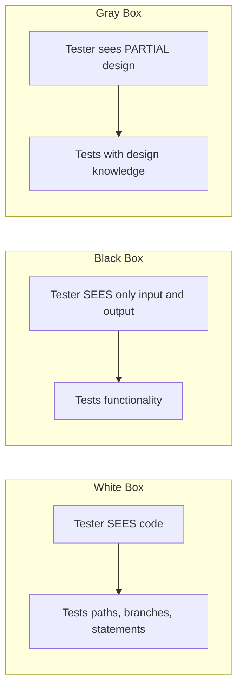

| Criteria | White Box | Black Box | Gray Box (+) |
|---|---|---|---|
| Knowledge of code | Full | None | Partial |
| Also called | Structural, glass-box | Behavioural, specification-based | Translucent |
| Tester | Developer | Tester / end user | Tester with technical knowledge |
| Level | Unit | System, acceptance | Integration |
| Basis | Code, design | Requirements (SRS) | Requirements + partial design |
| Techniques | Statement, branch, path coverage | BVA, equivalence partitioning, decision table | Matrix, pattern, regression |
| Programming skill | Required | Not required | Helpful |
| Time | More | Less | Medium |

---

## 2.5 Functional vs Non-Functional Testing

- **Functional:** checks **what** the system does (features). *Example:* Is login successful?
- **Non-Functional:** checks **how well** it works (performance, usability etc.) and readiness on parameters that functional testing cannot address. *Example:* How many users can log in at the same time?

| Criteria | Functional | Non-Functional |
|---|---|---|
| Checks | Features / business requirements | Performance, usability, security, compatibility |
| Based on | Functional requirements | Non-functional requirements (SRS) |
| Types | Unit, integration, system, acceptance | Load, stress, usability, compatibility, security |
| Example | Submit button saves record | Page loads in under 3 seconds |

### Performance Testing
- **Definition:** Checks whether the system works well under **heavy load**, measuring factors that determine overall performance.
- **Three parameters:** **Stability** (how long the system avoids failure), **Speed** (response time), **Scalability** (ability to handle growing load).
- **Advantages:** checks reliability; compares systems; evaluates overall performance.

| Type | Purpose | Example |
|---|---|---|
| **Load testing** | Behaviour under **normal and expected peak** load | 1,000 users on shopping site |
| **Stress testing** | Push **beyond limits** to find the breaking point and recovery | 10,000 users on a 1,000-user server |
| **Stability (endurance) testing** | Behaviour over a **long period** | Run for 72 hours; check memory leaks |

### Other non-functional types
- **Usability testing:** ease of use and navigation (menus, buttons, content).
- **Compatibility testing:** works across browsers, operating systems and devices.
- **Security testing:** unauthorised access, data protection, session handling.

---

## 2.6 Regression Testing

**Definition:** Re-executing a **full or partial set of already executed test cases** to confirm that a **recent code change has not broken existing functionality**.

**Why needed (points):**
1. Code changes may have **side effects** on working features.
2. Confirms old code still works after new changes.

**When to run (points):**
1. New requirement added to an existing feature.
2. New feature added.
3. Defects fixed in code.
4. Code optimised for performance.
5. Patches applied.
6. Configuration changed.

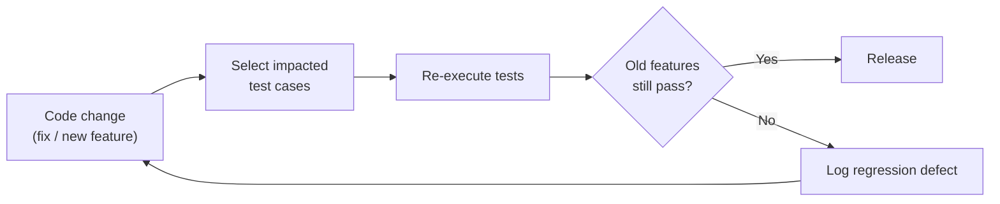

**Example:** After adding a "Pay by UPI" option, the tester re-runs the existing "Pay by Credit Card" and "Pay by Debit Card" tests.

| Criteria | Retesting | Regression Testing |
|---|---|---|
| Purpose | Confirm a **specific failed defect is fixed** | Confirm **other features are not broken** |
| Test cases | Same failed test cases | Already-passed test cases |
| Defect-based? | Yes | No |
| Automation | Hard to automate | **Best automated** |
| Priority | Done before regression | Done after retesting |

| Criteria (+) | Smoke Testing | Sanity Testing | Regression Testing |
|---|---|---|---|
| Purpose | Is the **build stable** enough to test? | Is the **specific fix/feature** working? | Is **existing functionality** unaffected? |
| Scope | Broad, shallow | Narrow, deep | Broad, deep |
| Performed | On every new build | After minor changes | After any change |
| Scripted | Yes (can be automated) | Usually unscripted | Yes (automated) |

---
# Unit III: Test Case Development

## 3.1 Test Documentation

**Definition:** Test documentation is the set of **artefacts created before or during testing**. It helps the team estimate effort, track coverage, resources and progress, and records planning, design, execution and results. Formats: `.doc`, `.xls`, `.txt`, `.html`, `.pdf`.

### Types of Test Documents

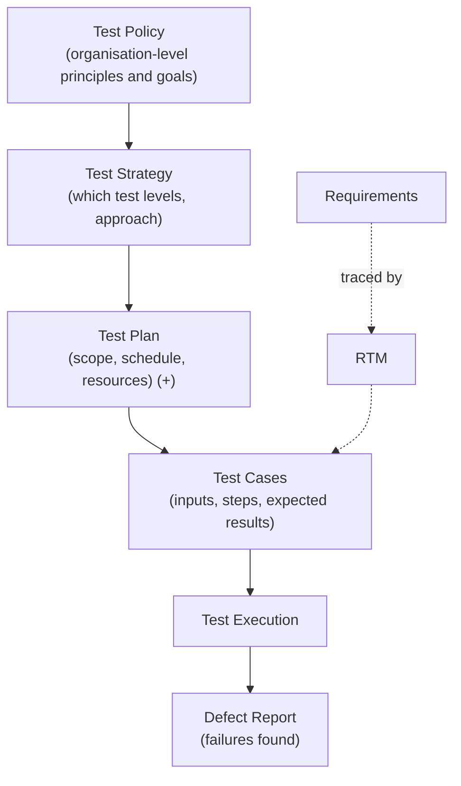

| Document | Description |
|---|---|
| **Test Policy** | High-level document: principles, methods and **testing goals of the whole organisation** |
| **Test Strategy** | High-level document: identifies **test levels** to be executed for a project |
| **Test Plan (+)** | Scope, approach, schedule, resources, risks of one project |
| **RTM** (Requirement Traceability Matrix) | **Connects requirements to test cases** |
| **Test Case** | Input values, pre-condition, steps, expected output, post-condition, result for a test scenario |
| **Defect Report** | Reports a flaw where the system fails to perform its expected function |

| Advantages | Disadvantages |
|---|---|
| Removes ambiguity while allocating tasks | Costly and time-consuming |
| Systematic approach; **training material** for freshers | Often written by people unsure what/how to write |
| Helps deliver quality product within time | Updating documents is tiring |
| Helps configuration through manuals | Poor documents make a good product look poor |
| Improves **transparency with clients** | |

---

## 3.2 Test Case

**Definition:** A test case is a **set of actions executed to verify a particular feature** of an application. It contains test steps, test data, pre-condition and post-condition to verify a requirement.

> **Real-life analogy (writing a letter):** Pre-condition = *must have a pen with refill*; Steps = *find pen, check refill, write letter*; Expected = *letter is written*; Post-condition = *letter is verified*.

### Test Case Components

| Field | Meaning |
|---|---|
| **Test Case ID** | Unique identifier (e.g. TC-01) for tracking |
| **Description / Objective** | What is being verified |
| **Pre-condition** | What must be in place **before** running (e.g. browser installed, user registered) |
| **Test Steps** | Actions performed, in order |
| **Test Data** | Input values used |
| **Expected Result** | What the system should do |
| **Actual Result** | What the system actually did (filled during execution) |
| **Status** | Pass / Fail |
| **Post-condition** | State after the test (e.g. login time saved in DB) |
| **Notes / Remarks** | Extra information |

### How to Write a Test Case (step-by-step)

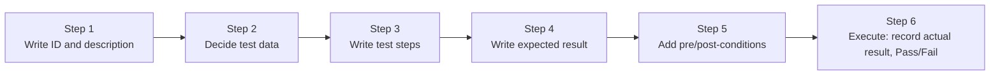

### Example 1: Login functionality (positive and negative)

| ID | Description | Pre-condition | Steps | Test Data | Expected Result | Actual Result | Status |
|---|---|---|---|---|---|---|---|
| TC-01 | Login with **valid** data | User is registered; browser open | 1. Open site 2. Enter user-id 3. Enter password 4. Click Submit | id = `kk`, pwd = `kk1` | User logs in successfully | As expected | **Pass** |
| TC-02 | Login with **invalid password** | Same | Same steps | id = `kk`, pwd = `abc` | Error message "Invalid credentials"; no login | Error shown | **Pass** |
| TC-03 | Login with **blank fields** | Same | Click Submit with empty fields | (empty) | "Fields are required" message | Page crashed | **Fail** |

**Post-condition (TC-01):** login date and time stored in the database.

### Example 2: Division by zero in Windows Calculator

| Field | Value |
|---|---|
| Test Case ID | TC-CALC-01 |
| Objective | Verify the calculator handles division by zero |
| Pre-condition | Calculator is open in Standard mode |
| Steps | 1. Enter `5` 2. Click `÷` 3. Enter `0` 4. Click `=` |
| Test Data | 5 ÷ 0 |
| Expected Result | Message "Cannot divide by zero" displayed; application does not crash |
| Post-condition | Calculator remains usable after pressing Clear |

### Points to remember while drafting
1. State the requirement being tested.
2. Explain how the system will be tested.
3. Machine configuration, OS and hardware must be set correctly.
4. Specify input, output and expected results.
5. A test case should not exceed **15 steps**.

### Best Practices for Good Test Cases
1. Keep them **simple** and clear.
2. **Avoid repetition.**
3. Keep the **end-user** in mind.
4. Do **not assume** features or functionality.
5. Ensure **100% requirement coverage**.
6. Use test-design techniques (BVA, EP: see Unit IV).
7. **Self-cleaning:** return the system to its original state.
8. **Identifiable:** unique ID helps defect tracking.
9. **Repeatable:** same result every time.
10. **Peer reviewed.**

---

## 3.3 Test Analysis

**Definition:** Checking and analysing **test artefacts (documents)** to derive test conditions and test cases. The goal is to **gather requirements and define test objectives**.

**Sources of test information:** SRS, BRS, FDD.

| Document | Full form | Description |
|---|---|---|
| **SRS** | Software Requirement Specification | **How the system should be built**; roadmap for everyone; high-level description; functional and non-functional specs; external interfaces; design constraints |
| **BRS** | Business Requirement Specification | **Formal document of client's requirements** (written and verbal); how trading partners perform roles and share duties; high-level functional specs |
| **FDD** | Functional Design Document | How a **process or system works**; no deep technical details; explains how people interact; shared with stakeholders for review and sign-off; time-consuming to maintain |

```mermaid
%%{init: {"flowchart": {"htmlLabels": false}}}%%
flowchart LR
    BRS["BRS<br/>(what the business wants)"] --> SRS["SRS<br/>(what the software must do)"] --> FDD["FDD<br/>(how it functions)"] --> TA["Test Analysis"] --> TC["Test Conditions and Test Cases"]
```

---

## 3.4 Requirement Traceability Matrix (RTM)

**Definition:** A document showing the **relationship between requirements and other artefacts** (test cases, test results, defects). It **proves that every requirement has been tested**.

**How to create RTM (3 steps):**
1. **Define your goal.**
2. **Establish artefacts and relationships** (requirement ↔ test case).
3. **Fill in the matrix** (in Microsoft Excel or any tool).

```mermaid
%%{init: {"flowchart": {"htmlLabels": false}}}%%
flowchart LR
    BR["Business Requirement"] --> FR["Functional Requirement"] --> TC["Test Case"] --> EX["Execution Result"] --> DF["Defect"]
```

**Example: Online Flight Booking**

| Business Req | Business Use Case | Functional Req | Functional Use Case | Priority | Test Case IDs |
|---|---|---|---|---|---|
| BR-1 | Reservation module | FR-1 | One-way ticket booking | High | TC001, TC002 |
| | | FR-2 | Round-trip ticket booking | Medium | TC003, TC004 |
| | | FR-3 | Multi-city booking | High | TC005, TC006 |
| BR-2 | Payment module | FR-4 | Pay by credit card | High | TC007, TC008 |
| | | FR-5 | Pay by debit card | High | TC009 |
| | | FR-6 | Pay by reward points | Low | TC010, TC011 |

**Example: Hospital Management System (two processes)**

| Req ID | Requirement | Priority | Test Cases |
|---|---|---|---|
| HMS-01 | Register a new patient | High | TC-P01 (valid data), TC-P02 (duplicate patient) |
| HMS-02 | Book doctor appointment | High | TC-A01 (free slot), TC-A02 (booked slot) |

**Advantages:** overview of all requirements; shows requirement-to-test linkage; ensures **100% coverage**; easy to prepare; no special tool needed.

**Types (+):** *Forward* (requirement → test case), *Backward* (test case → requirement), *Bi-directional* (both).

---

## 3.5 Test Data

**Definition:** The data collected and managed from various sources to **execute test cases**.

```mermaid
%%{init: {"flowchart": {"htmlLabels": false}}}%%
flowchart TD
    TD["Test Data"] --> V["Valid Data<br/>(program should accept and process)"]
    TD --> I["Invalid / Erroneous Data<br/>(program cannot process, must reject)"]
    TD --> E["Extreme / Boundary Data<br/>(at the edge of the valid range)"]
```

**Example:** Field "Age" accepts 18 to 60.

| Type | Values |
|---|---|
| Valid | 25, 40 |
| Invalid / erroneous | -5, 75, "abc", blank |
| Extreme / boundary | 17, 18, 60, 61 |

**How to create test data:**
1. **Manually**, mostly in an Excel sheet based on test scenarios and conditions (also `.doc`, `.txt`).
2. **Test data generator:** a specialised tool that generates **false (mock) data**; the simplest generator is Excel.

---

## 3.6 Test Case Management Tools (TCMT)

**Definition:** Tools that **help manage and maintain test cases**. Examples: **Jira**, **Quality Center (ALM)**, TestRail (+).

| Feature | Benefit |
|---|---|
| Documenting test cases | Templates speed up creation |
| Executing and recording results | Run test cases and store results in the tool |
| **Automated defect tracking** | Failed tests link to the bug tracker; email notification |
| **Traceability** | Requirements, test cases, execution, defects all interlinked |
| Protecting test cases | Reusable and safe from loss or corruption |

---
# Unit IV: Testing Techniques

## 4.1 Introduction

**Definition:** Testing techniques are the **methods used to test an application** against functional and non-functional requirements. Each technique finds a **specific type of defect** (e.g. structural defects vs end-to-end business-flow defects).

**5-fold view of any testing activity:**
1. **Testers**: who performs the testing.
2. **Coverage**: which components get covered.
3. **Potential problems**: why we test (the risk).
4. **Activities**: how we test.
5. **Evaluation**: how results are compared with expected results.

> The principles of testing (exhaustive testing impossible, early testing, Pareto 80/20 rule etc.) are covered in **Section 1.6**.

## 4.2 Classification of Techniques

```mermaid
%%{init: {"flowchart": {"htmlLabels": false}}}%%
flowchart TD
    ST["Software Testing Techniques"] --> STA["Static Testing<br/>(code NOT executed)"]
    ST --> DYN["Dynamic Testing<br/>(code IS executed)"]
    STA --> REV["Reviews"]
    STA --> SAN["Static Analysis"]
    REV --> R1["Informal review"]
    REV --> R2["Walkthrough"]
    REV --> R3["Technical review"]
    REV --> R4["Inspection"]
    SAN --> CF["Control flow"]
    SAN --> DF["Data flow"]
    DYN --> SB["Structure-based (white box)"]
    DYN --> EB["Experience-based"]
    DYN --> SP["Specification-based (black box)"]
    SB --> S1["Statement coverage"]
    SB --> S2["Decision coverage"]
    SB --> S3["Condition coverage"]
    SB --> S4["Multiple condition coverage"]
    EB --> E1["Error guessing"]
    EB --> E2["Exploratory testing"]
    SP --> P1["Equivalence partitioning"]
    SP --> P2["Boundary value analysis"]
    SP --> P3["Decision table testing"]
    SP --> P4["State transition testing"]
    SP --> P5["Use case testing"]
```

### Static vs Dynamic Testing

| Criteria | Static Testing | Dynamic Testing |
|---|---|---|
| Code execution | **Not executed** | **Executed** |
| What is checked | Documents, design, code (by reading) | Behaviour of running software |
| Goal | Prevent defects (verification) | Detect failures (validation) |
| Timing | Early in development | After code is ready |
| Cost | **Cheaper**; reduces cost of fixing | More expensive; time-consuming |
| Techniques | Reviews, static analysis | White box, black box, experience-based |
| Example | Reviewing the SRS for ambiguity | Running login with wrong password |

---

## 4.3 Static Testing Techniques

### A. Reviews
Documents are **directly examined by people** and discrepancies are sorted out. Finds defects in the **design** of the program without executing it.

| Review Type | Key points | Formal? |
|---|---|---|
| **Informal review** | No formal process or restriction; reviewer checks whatever he wants; e.g. a colleague glances at the code | No |
| **Walkthrough** | **Author leads** the team step by step through the document; used for learning and early feedback | Semi |
| **Technical review** | Technical peers check documents (SRS, code, product design) against **standards and specifications** | Yes |
| **Inspection** | **Most formal**; trained moderator; checklist; entry/exit criteria; checks against development standards and guidelines; defects are logged | Highest |

### B. Static Analysis
Finds potential defects **in the code** without running it, usually with tools.

| Type | Focus | Example defect found |
|---|---|---|
| **Control flow analysis** | Calling structure, functions, methods, branching | Unreachable code, infinite loop |
| **Data flow analysis** | **How data objects are defined and used** | Variable used before it is initialised |

---

## 4.4 Structure-Based Techniques (White Box Coverage)

Test cases are derived from the **code structure**. Coverage measures how much of the code the tests exercised.

**Sample code for all examples below:**

```text
1   x = 0
2   if (a > 0 AND b > 0)
3       x = a + b
4   print(x)
```

| Technique | What must be covered | Tests for the code above |
|---|---|---|
| **Statement coverage** | **Every statement** executed at least once | 1 test: `a=1, b=1` (100%) |
| **Decision (branch) coverage** | Every decision takes **both True and False** outcome | 2 tests: `a=1,b=1` (True) and `a=0,b=1` (False) |
| **Condition coverage** | **Each atomic condition** (`a>0`, `b>0`) takes both True and False | 2 tests: `a=1,b=0` and `a=0,b=1` |
| **Multiple condition coverage** | **All combinations** of condition outcomes | 4 tests: TT, TF, FT, FF |

**Formula:** Statement coverage % = (Statements executed ÷ Total statements) × 100

**Key observations (exam points):**
1. Statement coverage is the **weakest**: the False path is never tested.
2. 100% decision coverage **implies** 100% statement coverage, but not the reverse.
3. In the example, condition coverage tests `(1,0)` and `(0,1)`: the decision is **False both times**, so it does **not** guarantee decision coverage.
4. Multiple condition coverage is the **strongest** but needs 2ⁿ tests for n conditions.

---

## 4.5 Experience-Based Techniques

| Technique | Description | Example |
|---|---|---|
| **Error guessing** | Tester uses **experience and intuition** to guess where defects are likely | Enter blank, very long text, special characters, zero, negative numbers in a form |
| **Exploratory testing** | **Simultaneous learning, test design and execution**; no prior scripts; tester explores the app and notes findings | Tester explores a new e-commerce site without a test script |

Used when **specifications are poor or time is short**, and to complement formal techniques.

---

## 4.6 Specification-Based Techniques (Black Box) (+)

> These are the most important techniques for the exam. Learn the **steps and one solved example for each**.

### A. Equivalence Partitioning (EP)

**Definition:** Input data is divided into **partitions (classes)** where all values are expected to behave the same. **One value from each partition** is enough to test it.

**Steps:**
1. Identify the input conditions.
2. Divide into **valid** and **invalid** classes.
3. Pick **one representative value** from each class.

**Example: Exam marks (0 to 100)**

```mermaid
%%{init: {"flowchart": {"htmlLabels": false}}}%%
flowchart LR
    I1["Invalid<br/>less than 0"] --- V1["Fail<br/>0 to 39"] --- V2["Pass<br/>40 to 59"] --- V3["Merit<br/>60 to 74"] --- V4["Distinction<br/>75 to 100"] --- I2["Invalid<br/>more than 100"]
```

| Partition | Range | Test value | Expected |
|---|---|---|---|
| Invalid (low) | < 0 | -5 | Error |
| Fail | 0-39 | 20 | Fail |
| Pass | 40-59 | 50 | Pass |
| Merit | 60-74 | 65 | Merit |
| Distinction | 75-100 | 90 | Distinction |
| Invalid (high) | > 100 | 105 | Error |

**Result:** 6 test cases instead of 100+.

### B. Boundary Value Analysis (BVA)

**Definition:** Defects occur **most often at the edges** of input ranges, so test values **at and around the boundaries**.

**Steps:** find the min and max of the valid range → pick values at and next to each boundary.

| Variant | Values tested |
|---|---|
| **Standard BVA** | min, min+1, nominal, max-1, max (5 values) |
| **Robust BVA** | Standard + (min-1) and (max+1) (7 values) |

For **n variables**: standard BVA = **4n + 1** tests; robust BVA = **6n + 1** tests.

**Example: Age field accepts 18 to 60**

```mermaid
%%{init: {"flowchart": {"htmlLabels": false}}}%%
flowchart LR
    A["17<br/>invalid"] --- B["18<br/>MIN valid"] --- C["19"] --- D["39<br/>nominal"] --- E["59"] --- F["60<br/>MAX valid"] --- G["61<br/>invalid"]
```

| Test | Value | Expected |
|---|---|---|
| Standard | 18, 19, 39, 59, 60 | Accepted |
| Robust (extra) | 17 | Rejected |
| Robust (extra) | 61 | Rejected |

### EP vs BVA

| Criteria | Equivalence Partitioning | Boundary Value Analysis |
|---|---|---|
| Idea | One value represents the whole class | Test the **edges** of each class |
| Picks | Any value from the partition | Min, max and neighbours |
| Tests | Fewer | More, focused on edges |
| Finds | General class-handling errors | **Off-by-one** errors (`<` vs `<=`) |
| Used | **Together** (EP first, then BVA on each boundary) | |

### C. Decision Table Testing

**Definition:** Used when output depends on a **combination of conditions**. Conditions and actions are listed in a table, each column is a **rule** (one test case). With n conditions there are **2ⁿ rules**.

**Example 1: Login (2 conditions → 4 rules)**

| | Rule 1 | Rule 2 | Rule 3 | Rule 4 |
|---|---|---|---|---|
| **C1:** Username valid? | T | T | F | F |
| **C2:** Password valid? | T | F | T | F |
| **Action:** Login success | **Yes** | No | No | No |
| **Action:** Show error | No | Yes | Yes | Yes |

**Example 2: Shopping discount**
Conditions: *Member?* and *Order ≥ ₹1000?*

| | R1 | R2 | R3 | R4 |
|---|---|---|---|---|
| Member? | Y | Y | N | N |
| Order ≥ 1000? | Y | N | Y | N |
| **Discount** | 20% | 10% | 5% | 0% |

Each rule becomes **one test case** (4 test cases).

### D. State Transition Testing

**Definition:** Used when the system's behaviour **depends on its current state and past events**. Test cases are derived from **states, events (inputs), transitions and actions**.

**Example: ATM PIN entry (card blocked after 3 wrong attempts)**

```mermaid
stateDiagram-v2
    [*] --> CardInserted : Insert card
    CardInserted --> Try1 : Enter PIN
    Try1 --> Authenticated : PIN correct
    Try1 --> Try2 : PIN wrong
    Try2 --> Authenticated : PIN correct
    Try2 --> Try3 : PIN wrong
    Try3 --> Authenticated : PIN correct
    Try3 --> CardBlocked : PIN wrong
    Authenticated --> [*] : Transaction done
    CardBlocked --> [*]
```

| Test case | Event sequence | Expected final state |
|---|---|---|
| 1 | Correct PIN first time | Authenticated |
| 2 | Wrong, then correct | Authenticated |
| 3 | Wrong, wrong, correct | Authenticated |
| 4 | Wrong, wrong, wrong | **CardBlocked** |
| 5 (invalid transition) | Try to withdraw from CardInserted without PIN | Rejected |

**Good for:** ATM, login lock-out, order status (placed → shipped → delivered), traffic lights.

### E. Use Case Testing

**Definition:** Test cases are derived from **use cases** (how an actor interacts with the system to achieve a goal). Tests the **end-to-end business flow**.

**Use case elements:** actor, pre-condition, **main flow**, **alternate flows**, post-condition.

**Example: ATM cash withdrawal**

```mermaid
%%{init: {"flowchart": {"htmlLabels": false}}}%%
flowchart TD
    A["Actor inserts card and enters PIN"] --> B{"PIN valid?"}
    B -- "No (alternate flow)" --> X1["Show error; retry or block card"]
    B -- "Yes" --> C["Enter amount"]
    C --> D{"Balance enough?"}
    D -- "No (alternate flow)" --> X2["Show 'Insufficient balance'"]
    D -- "Yes (main flow)" --> E["Dispense cash and update balance"]
    E --> F["Print receipt; eject card"]
```

| Test case | Flow | Expected |
|---|---|---|
| TC1 | Main flow | Cash dispensed, balance reduced |
| TC2 | Alternate: wrong PIN | Error message |
| TC3 | Alternate: insufficient balance | Message; no cash |

### Comparison of Specification-Based Techniques

| Technique | Best when | Focus | Example |
|---|---|---|---|
| Equivalence partitioning | Large input range | Reduce number of tests | Marks 0-100 |
| BVA | Numeric ranges | Edge values | Age 18-60 |
| Decision table | Multiple conditions combine | Business rules | Discount, loan approval |
| State transition | Behaviour depends on history | States and events | ATM PIN, order status |
| Use case | End-to-end flows | Real user scenarios | Withdraw cash |

---
# Unit V: Testing Different Domains

**Domain testing** means testing software with knowledge of the **business area** it serves (web, banking, e-commerce, healthcare, insurance, telecom). A tester who knows the domain finds more meaningful defects.

**Why domain knowledge matters (points):**
1. Reduces training time.
2. Helps in **quick defect tracking**.
3. Gives a good idea of UI features and **back-end processing**.
4. Gives a hold on workflows, business processes and rules.
5. Makes technical terminology easy to understand.

---

## 5.1 Web Domain Testing

**Definition:** Checking a website / web application for **bugs before it goes live**. It covers functionality, usability, security, compatibility and performance, plus traffic handling.

- Built using **HTML, CSS, JavaScript**; hosted as static or dynamic; can be a single-page, multi-page or progressive web app.
- Test levels: **unit** (JavaScript/Python) → **integration** (modules) → **system** (full app) → **acceptance** and **performance**.
- Test on multiple browsers: Chrome, Safari, Edge, Firefox, Opera. Excel is commonly used for test-case design.

```mermaid
%%{init: {"flowchart": {"htmlLabels": false}}}%%
flowchart TD
    WT["Web Application Testing"] --> FN["Functionality"]
    WT --> US["Usability"]
    WT --> IF["Interface"]
    WT --> DB["Database"]
    WT --> CP["Compatibility"]
    WT --> PF["Performance"]
    WT --> SC["Security"]
    WT --> CR["Crowd Testing"]
```

| Type | What is tested (points) | Tools |
|---|---|---|
| **Functionality** | **Links:** outgoing, internal, anchor, mail-to; **HTML/CSS:** syntax errors, colour scheme, standards compliance; **Forms:** field validation, default values, error messages; **Business workflows:** end-to-end flow across pages, including negative scenarios; **Database/live data** is correct | QTP, Selenium |
| **Usability** | **Navigation:** menus, buttons, links; **Content:** no spelling/grammar mistakes, images have **alt text** | Chalkmark, Clicktale, Feedback Army |
| **Interface** | Communication between **web server, application server and database server**; queries return expected results; errors shown to **admin**, not to end users; no denial of service; all requests handled | |
| **Database** | Errors during query execution; **data integrity** (create/update/delete); query **response time**; data shown on page is accurate | QTP, Selenium |
| **Compatibility** | **Browser** compatibility; **OS** compatibility (Windows, Linux, Mac); different devices and screen sizes | NetMechanic |
| **Performance** | Response time at different connection speeds; **load** at normal and peak; **stress** at peak; crash recovery; optimisation (e.g. gzip compression) | LoadRunner, JMeter |
| **Security** | No access to secure pages without login; restricted files not downloadable without access; **session auto-expires** after inactivity; **SSL**: site redirects to encrypted (HTTPS) pages | Vulnerability scanners (e.g. Intruder: 10,000+ security checks) |
| **Crowd testing** | Performed by a **large group of people** (testers across the world) | |

```mermaid
%%{init: {"flowchart": {"htmlLabels": false}}}%%
flowchart LR
    B["Browser (client)"] -->|"HTTP request"| W["Web Server"] --> AP["Application Server"] --> D[("Database Server")]
    D --> AP --> W -->|"response"| B
```

**Example test cases (web application start-up and navigation):**

| ID | Name | Pre-condition | Objective | Steps | Expected | Status |
|---|---|---|---|---|---|---|
| T101 | URL check | Internet connection on | Verify the URL works | 1. Type URL in address bar 2. Press Enter | Web application opens successfully | Pass |
| T102 | Navigation check | Internet connection on | Verify navigation from Contact Us page to Home page | 1. Open the web app 2. Visit Contact Us 3. Click Home | Home page opens | Pass |

---

## 5.2 Finance / Banking Domain Testing

**Definition:** Testing banking applications (money transfer, deposit, withdrawal, balance enquiry, fixed deposits) so that the software **runs smoothly without errors and remains protected**.

**Three main testing processes:** **Functionality, Performance, Security.**

**Characteristics of banking applications (points):**
1. Supports **thousands of concurrent user sessions**.
2. Integrates with Demat accounts, credit/debit cards, bill-pay utilities.
3. **Fast and secure transactions**; massive storage.
4. Handles **complex business workflows**.
5. Runs on multiple platforms (Linux, Unix, Windows) and from multiple locations.
6. **Multi-lingual** users; supports payment systems (Visa, Mastercard, AMEX).
7. Supports multiple service sectors (retail, loan, etc.).

**Banking sectors:**

| Traditional banking | Service-based banking (additional) |
|---|---|
| Core banking | Loan banking |
| Corporate banking | Trade banking |
| Retail banking | Private banking, consumer finance, Islamic finance |
| | Customer delivery channels (ATM, net banking, mobile) |

**Example: Fund transfer test scenarios**

| ID | Scenario | Expected |
|---|---|---|
| FT-01 | Transfer valid amount to valid account | Debit and credit done; SMS/receipt sent |
| FT-02 | Transfer more than available balance | "Insufficient funds"; no debit |
| FT-03 | Wrong OTP entered | Transaction rejected |
| FT-04 | Network fails mid-transaction | **No double debit**; transaction rolled back |
| FT-05 | 1,000 users transfer at the same time | Response within limit; all balances correct |

```mermaid
sequenceDiagram
    participant C as Customer
    participant A as Banking App
    participant S as Core Banking Server
    C->>A: Enter payee, amount, OTP
    A->>S: Validate and process transfer
    S->>S: Debit sender, credit receiver (atomic)
    S-->>A: Success / failure
    A-->>C: Confirmation message
```

**Key test focus:** **Security** (encryption, OTP, session timeout), **transaction integrity** (ACID), **performance** at peak, **audit trail**.

---

## 5.3 E-Commerce Domain Testing

**Definition:** Evaluating and validating an online store for **reliability, functionality and security** (e.g. an online shopping site). It prevents errors and ensures conformity to client requirements.

**Objectives:** software reliability, software quality, system assurance, optimum performance.

```mermaid
%%{init: {"flowchart": {"htmlLabels": false}}}%%
flowchart LR
    BR["Browse / search catalogue"] --> CT["Add to cart"] --> CK["Checkout"] --> PY["Payment"] --> OR["Order confirmation"] --> TR["Order tracking"] --> DL["Delivery / returns"]
```

| Type of testing | What is tested |
|---|---|
| **Functionality** | Test cases from business requirements; execute; analyse results; report defects |
| **Usability** | Intuitive design, site navigation, help support, catalogue navigation; test with real users |
| **Security** | Vulnerability assessment, security patches, updated protocols |
| **Session management** | Session expiry and session storage |
| **Browser compatibility** | Support for every browser and platform (Windows, Linux) |
| **Page display** | Incorrect display, runtime errors, slow download, dead links, font size, plugin dependency |
| **Content analysis** | No misleading/offensive content, royalty-free images, personalisation, 24/7 availability |
| **Availability** | Denial-of-service attack; unacceptable downtime |
| **Backup and recovery** | Failure recovery, backup failure, fault tolerance |
| **Transactions** | Transaction integrity, throughput, auditing |
| **Shopping and order processing** | Cart functionality, order processing, **payment processing**, order tracking |
| **Internationalisation** | Language support and display, cultural sensitivity, regional accounting (currency, tax) |

**Example scenarios:** add item to cart → quantity update changes total; apply invalid coupon → error; payment fails → order not created and cart retained.

---

## 5.4 Healthcare Domain Testing

**Definition:** Testing healthcare applications for **standards, safety, compliance and cross-dependency** with other entities.

**Objectives:** reliability, quality, **system safety**, optimum performance, efficiency.

**Stakeholders:** patient/consumer, hospital, insurance company, healthcare/life-science solution vendors, regulatory authority.
**Standards and forms:** **HIPAA** (privacy and security of health data), **OASIS** (home-health assessment data set), **HCFA-1500 / CMS-1500** (claim form).

```mermaid
%%{init: {"flowchart": {"htmlLabels": false}}}%%
flowchart LR
    PR["Patient registration"] --> SC["Scheduling<br/>(appointment)"] --> TR["Treatment"] --> BL["Billing and claims"]
```

| System tested | Test activities |
|---|---|
| **Provider system** (doctor / hospital) | Add and update doctor/hospital information; login; claim status; invalid credentials |
| **Broker system** (insurance agent) | Add and update broker info; agency and agent details; cashless and cash-return services |
| **Patient system** | Add / edit / view patient; generate premium bill and payment; registration; dependants (family) maintenance |
| **Claim system** | Cashless vs cash-return claim; handling **government scheme** claims; validate **invalid procedure and diagnosis codes** |

**Key focus:** **data privacy (HIPAA)**, accuracy of patient data, **safety-critical workflows**, interoperability, audit logs.

---

## 5.5 Insurance Domain Testing (+)

> The slide for this topic repeats the healthcare content, so a standard summary is given here.

**Definition:** Testing applications that manage **policies, premiums and claims**.

```mermaid
%%{init: {"flowchart": {"htmlLabels": false}}}%%
flowchart LR
    NB["New business<br/>(proposal)"] --> UW["Underwriting<br/>(risk assessment)"] --> PL["Policy issue"] --> PM["Premium collection"] --> CL["Claim processing"] --> RN["Renewal / lapse"]
```

| Area | Example test scenarios |
|---|---|
| Policy issue | Policy number is unique; correct sum assured and term |
| Premium calculation | Premium changes correctly with age and cover amount (BVA on age limits) |
| Payment | Late payment adds penalty; auto-debit works |
| Claims | Claim above sum assured rejected; documents mandatory; claim status updates |
| Renewal | Reminder before due date; lapsed policy revival rules |
| Compliance | Regulatory rules (IRDAI in India); data privacy |

---

## 5.6 Telecom Domain Testing (+)

> The source slides list this topic but contain no content, so a standard summary is given here.

**Definition:** Testing of telecom software: **billing, customer management, network operations and service provisioning**.

| Area | Description | Example test |
|---|---|---|
| **Billing system** | Calculates usage charges, plans, taxes | 100 minutes of calls on a plan produce the correct bill |
| **CRM** | Customer data, complaints, plan changes | New SIM activation updates customer record |
| **Provisioning / activation** | Enables services after purchase | Recharge enables data pack immediately |
| **Mediation / usage records** | Collects call data records (CDR) | No missing or duplicate call records |
| **Network and performance** | Millions of users | Load test during festival peak |
| **Interoperability** | Works across operators and devices | Roaming charges between networks |

**Key focus:** **billing accuracy**, **high load / scalability**, real-time processing, security of customer data.

---

## 5.7 Comparative Study of Domains

| Domain | Main concern | Typical tests | Compliance / standard |
|---|---|---|---|
| **Web** | Works for everyone, everywhere | Functionality, compatibility, usability, security | W3C, accessibility |
| **Banking** | **Security and transaction integrity** | Security, performance, functionality | RBI rules, PCI-DSS |
| **E-commerce** | Smooth purchase and payment | Cart, payment, session, load | PCI-DSS, consumer laws |
| **Healthcare** | **Patient safety and data privacy** | Claim, patient data, provider systems | HIPAA, OASIS, HCFA-1500 |
| **Insurance** | Correct premium and claim handling | Calculation, claim workflow | IRDAI |
| **Telecom** | **Billing accuracy and scale** | Billing, load, interoperability | TRAI rules |

---
# Unit VI: Understanding Agile Testing

## 6.1 Agile: Definition and Concepts

**Definition:** Agile is a software development approach based on **iterative and incremental development**. Work is broken into **small iterations (1 to 4 weeks)**; every iteration produces a **working product** that is demonstrated to the customer.

**Key points:**
1. Agile means *swift, flexible, adaptive*.
2. **Changes in requirements are welcomed** at any point.
3. Minimal upfront planning; risk is reduced by delivering in small parts.
4. Each iteration runs a **full mini-SDLC**: planning → requirements → design → coding → testing → demo.
5. Popular methods: **Scrum, Extreme Programming (XP), Crystal, FDD, DSDM, RUP**. The **Agile Manifesto** was published in **2001**.

**Agile Manifesto: four values (+)**

| We value | over |
|---|---|
| Individuals and interactions | Processes and tools |
| Working software | Comprehensive documentation |
| Customer collaboration | Contract negotiation |
| Responding to change | Following a plan |

```mermaid
%%{init: {"flowchart": {"htmlLabels": false}}}%%
flowchart LR
    PL["Plan"] --> RQ["Requirements"] --> DS["Design"] --> CD["Code"] --> TS["Test"] --> DM["Demo to client"]
    DM -->|"feedback, next iteration"| PL
```

| Advantages | Disadvantages |
|---|---|
| Flexibility and adaptability | Training and new skills required |
| Creativity and innovation | Organisational transformation needed |
| Faster time-to-market | Scalability to large teams is difficult |
| Lower cost and improved quality | Integration with traditional project management |
| Customer and employee satisfaction | |

| Criteria | Waterfall | Agile |
|---|---|---|
| Approach | Sequential, one pass | Iterative, repeated cycles |
| Requirements | Fixed upfront | Change welcomed |
| Testing | After coding (late) | **Every sprint (continuous)** |
| Delivery | One final delivery | Frequent working increments |
| Customer role | At start and end | **Throughout** |
| Documentation | Heavy | Light |
| Risk | Found late | Found early |

---

## 6.2 Scrum Framework

**Definition:** Scrum is an agile process for **managing tasks in team-based development**.

| Role | Responsibility |
|---|---|
| **Product Owner** | Creates and **prioritises the product backlog**; decides what is delivered in each iteration |
| **Scrum Master** | Sets up the team, arranges meetings, **removes obstacles** |
| **Scrum Team** | Self-organised; plans and completes the **sprint** work |

```mermaid
%%{init: {"flowchart": {"htmlLabels": false}}}%%
flowchart LR
    PB["Product Backlog<br/>(prioritised features)"] --> SP["Sprint Planning<br/>Meeting"] --> SB["Sprint Backlog"] --> SPR["Sprint (1-4 weeks)<br/>with Daily Stand-up"] --> FW["Finished Work<br/>(potentially shippable)"]
    SPR --> RV["Sprint Review<br/>(demo to stakeholders)"] --> RT["Sprint Retrospective<br/>(what to improve)"]
    RT --> PB
```

**Benefits of Scrum:** higher quality deliverables; copes better with change; better estimates with less effort; better control of schedule and project state.

---

## 6.3 Agile Testing

**Definition:** Testing that follows agile principles: **testers work with developers from day one**, and testing happens **within each sprint** instead of at the end.

**Key points:**
1. We **test in iterations** and **test early**.
2. Testers are part of an integrated, team-oriented approach.
3. Principles: **continuous feedback**, **constant improvement**, **focus on people**.
4. Less documentation; more room for adaptation.
5. **Ideal agile tester skills:** communication, automation and scripting, general testing skills.
6. Common methods: **exploratory testing, TDD, BDD, ATDD, integration testing**.

**Benefits:** increased interaction, high-quality product, faster delivery.

| Criteria | Traditional Testing | Agile Testing |
|---|---|---|
| Tester joins | After development | **From the start** |
| Test timing | End phase | Every sprint |
| Documentation | Detailed test plans | Lightweight, user stories |
| Feedback | Late | Continuous |
| Role of tester | Independent gatekeeper | **Part of the team** |
| Requirement changes | Hard to handle | Expected |

### Agile Test Strategy

```mermaid
%%{init: {"flowchart": {"htmlLabels": false}}}%%
flowchart LR
    RP["Release Planning<br/>(test plan)"] --> SQ["Each Sprint<br/>(QA activities)"] --> HS["Hardening Sprint<br/>(system test, end game)"] --> RQ["Release<br/>(exit criteria, retrospective)"]
```

| Stage | QA activities |
|---|---|
| **Release planning** | Create high-level test plan and budget time; join **story sizing**. A typical plan covers: scope, new functionality, test types/levels, performance and load, infrastructure, risks and mitigation, resourcing, milestones |
| **Each sprint** | Join sprint planning; **estimate tasks**; write test cases from stories (high-level before coding, detailed during coding); **unit/integration tests** by developers (run nightly); **pair tests** (Dev + QA); **feature tests** by QA; reviews with customer and programmer; **automate** new functional tests and run automated regression; non-functional tests (load, security, usability); **demo** to stakeholders |
| **Hardening sprint** | Fix prioritised bugs; **end game** with whole team: mock deploy on staging, smoke test, non-functional tests, **complete regression**, **UAT**, compatibility, installation, localisation |
| **Release** | Define **exit criteria** (bug severity, open bugs, coverage, documentation ready); join **retrospective** (start, stop, continue) |

---

## 6.4 Test-Driven Development (TDD)

**Definition:** TDD is a technique for building software by **writing tests first** and then writing the code to pass them. *(Martin Fowler)*

**Key points:**
1. TDD is **primarily about design**, not just testing. Design evolves through **refactoring**.
2. **Developers** (not testers) write **unit tests**, then the code.
3. Unit tests written *after* the code are only "plain old unit testing", not TDD.

### Red-Green-Refactor cycle

```mermaid
%%{init: {"flowchart": {"htmlLabels": false}}}%%
flowchart LR
    R["RED<br/>Write a small failing test"] --> G["GREEN<br/>Write just enough code to pass"] --> RF["REFACTOR<br/>Remove duplication, clean the code"]
    RF --> R
```

**Process cycle (5 steps):**
1. Add a little test.
2. Run all tests and **see the new one fail**.
3. Make a little change.
4. Run the tests and **all succeed**.
5. Refactor to remove duplication.

**Three laws of TDD:**
1. Do **not write production code** unless you first have a **failing unit test**.
2. Do **not write more of a unit test** than is sufficient to fail.
3. Do **not write more production code** than is sufficient to pass the failing test.

**Example (calculator `add`):**
- RED: write `assert add(2,3) == 5`: fails (function does not exist).
- GREEN: write `function add(a,b){ return a+b; }`: test passes.
- REFACTOR: tidy code, add test for negative numbers, repeat.

**Disadvantages of writing tests after code:**
1. No direct feedback to design; unit tests are often **skipped** once the code works.
2. Results in **"happy path" testing** only; code is not granular enough to test.

| Benefits of TDD | Explanation |
|---|---|
| Better design | Cleaner code due to refactoring |
| Safer refactoring | Tests protect existing behaviour |
| Better code coverage | Every feature has a test |
| Faster debugging | Failure is in the most recently changed code |
| Self-documenting | Tests show how to use the code |

**Tools:** JUnit, TestNG, JWalk, Mockito (Java); Jest, Mocha (JavaScript) (+).
**Myth:** "TDD slows development": a direct route can be slower than the highway; TDD reduces rework and bug-fixing time.

---

## 6.5 Behaviour-Driven Development (BDD)

**Definition:** BDD is about implementing software by **describing its behaviour from the perspective of stakeholders and customers**. *(Dan North)* It is an **outside-in, pull-based, multi-stakeholder** agile methodology with high automation.

**Key points:**
1. Focus on **expected behaviour** of the application; requirements as **user stories**.
2. User stories are created and maintained **collaboratively** by all stakeholders.
3. **Outside-in:** start from business need → write behaviour → then code.
4. **Pull-based:** stories are prioritised by business value and the team commits to them (vs push-based: deliver by a deadline).

**Given-When-Then format:**

```mermaid
%%{init: {"flowchart": {"htmlLabels": false}}}%%
flowchart LR
    G["GIVEN<br/>initial context"] --> W["WHEN<br/>an action happens"] --> T["THEN<br/>expected outcome"]
```

**Example: Login**
```gherkin
Feature: User login
  Scenario: Login with valid credentials
    Given the user is on the login page
    When the user enters username "kk" and password "kk1"
    Then the user sees the dashboard
```

**Benefits:** verifiable, executable, unambiguous requirements; builds features with real **business value**; **prevents defects** rather than finding them; brings QA to the forefront.

**What BDD is NOT:** just unit testing with another framework; only using Given/When/Then; only the tester's responsibility; an alternative to manual testing.

**Tools:** Cucumber (Ruby/Java/JS), Behat (PHP), Jasmine (JavaScript), Concordion (Java).

---

## 6.6 Acceptance Test-Driven Development (ATDD)

**Definition:** ATDD is a collaborative practice where **customers, developers and testers define acceptance tests before development begins**. Tests are **not unit tests**; they express business expectations.

```mermaid
%%{init: {"flowchart": {"htmlLabels": false}}}%%
flowchart LR
    DI["DISCUSS<br/>Team clarifies the story<br/>and writes concrete examples"] --> DE["DEVELOP<br/>Automate acceptance tests;<br/>build code using TDD"] --> DL["DELIVER<br/>Feature released;<br/>acceptance tests pass"]
    DL -->|"next story"| DI
```

**Example: Story "secure passwords"**
> *As an administrator, I want users to choose secure passwords so that accounts cannot be hacked by a password-guessing program.*

| Password | Valid? |
|---|---|
| `p@ssw0rd1` (8+ chars with letter, number, symbol) | Yes |
| `p@s5` (too short) | No |
| `password` (no number or symbol) | No |

Expressed as: **Given** a user is creating an account, **When** they enter an insecure password, **Then** an error message states the rules.

**Frameworks:** Cucumber (Given-When-Then), **FitNesse** (wiki tables), **Robot Framework** (keyword-driven), Concordion (prose).

**Characteristics of ATDD-friendly frameworks:** express expectations in a suitable language; support whole-team collaboration; connect to the system with minimal test code (fixtures); work with source control and CI; pluggable to many interfaces.

**Contrast with traditional automation:** traditional scripts are written *after the fact*, mixing business expectations with implementation detail (expectations are *translated*). ATDD *leverages* expectations as executable specs.

### TDD vs BDD vs ATDD

| Criteria | TDD | BDD | ATDD |
|---|---|---|---|
| Full form | Test-Driven Development | Behaviour-Driven Development | Acceptance Test-Driven Development |
| Focus | **Code design / unit** | **Behaviour** from user view | **Acceptance criteria** |
| Written by | Developers | Developers + testers + business | Customer + developer + tester ("three amigos") |
| Test level | Unit tests | Scenario / feature tests | Acceptance tests |
| Language | Programming language | Plain English (Given-When-Then) | Plain English / tables |
| Question answered | "Does the code work right?" | "Does it behave as expected?" | "Does it meet the customer's need?" |
| Tools | JUnit, TestNG, Jest | Cucumber, Behat, Jasmine | FitNesse, Robot, Cucumber |
| Starts with | Failing unit test | User story scenario | Acceptance example |

---

## 6.7 Agile Estimation

**Definition:** Measuring **how long a user story or task will take**, used for planning, resource allocation, prioritising and budgeting. Without estimation, the team may deliver an undesired product late and leave the customer unsatisfied.

**Why estimate (points):** decides how much work fits in a sprint; helps plan the project; resource allocation; decide priority (Task A vs B); project quotations; splitting backlog into small tasks makes workload visible.

**Three levels of estimation:**

| Level | Description |
|---|---|
| **Project / proposal level** | Done early using quick function-point analysis |
| **Release level** | Assign **story points** to user stories; decide which stories go into the current release |
| **Sprint level** | Stories broken into **tasks with estimated hours**; owner assigned; used for budget |

**Estimating tasks (bottom-up):** team members estimate effort in hours; disagreements are discussed to **consensus**; a task of **more than 6 hours is split**; tasks **under 2 hours are combined**.

**Principles:**
1. Techniques are **collaborative** (whole team); no one can be blamed for a wrong estimate.
2. Designed to be **fast** and deliberately trade accuracy for speed.
3. Use **relative units** (story points, sizes) rather than days or money, since humans compare things better than they measure them.

**Nine estimation techniques:**

| # | Technique | How it works |
|---|---|---|
| 1 | **Planning poker** | Each member picks a card (Fibonacci: 1, 2, 3, 5, 8, 13...); all reveal together; discuss differences; re-vote |
| 2 | **Bucket system** | Stories are placed into buckets of increasing size |
| 3 | **Big / Uncertain / Small** | Items sorted into three size groups |
| 4 | **Too Big / No Clue / One Sprint (TFB/NFC/1 Sprint)** | Items classified as too big, unknown or fits in one sprint |
| 5 | **Dot voting** | Members place dots on items to show priority or size |
| 6 | **T-shirt sizes** | Items sized S, M, L, XL |
| 7 | **Affinity grouping** | Similar-sized items grouped together silently |
| 8 | **Ordering protocol** | Items arranged in order of relative size |
| 9 | **Divide until maximum size** | Large items split until each is within the maximum size |

**Agile templates:**

| Template | Purpose |
|---|---|
| Project plan | High-level view of time to deliver requirements, status, owner |
| Release plan | Tasks per release with status and sprint |
| Product backlog | Complete backlog with status, priority, story points |
| Sprint backlog | Stories of one sprint broken into tasks; daily status (burn-down) |
| Test plan | Test scenario broken into sub-scenarios; expected vs actual result; status |
| User story | *As a (user), I want (task), so that (goal)* |
| Road map | Short- and long-term direction of the project |

---

## 6.8 Defect Management in Agile

**Definition of a defect:**
- **Producer's view:** a deviation from specifications: missing, wrong or extra.
- **Customer's view:** anything that causes **customer dissatisfaction**, whether in the requirements or not ("fit for use").

**Principles (points):**
1. Main goal is to **prevent** defects; imperfect processes cause most defects.
2. Defect management is **risk-driven** (priorities and resources based on risk).
3. **Defect measurement** is part of the development process and used to improve it.

**Defect report structure:**

| Field | Content |
|---|---|
| **Title** | Clear one-line problem (e.g. "Missing validation in Project field"). Categories: missing, inaccurate, incomplete, inconsistent, incorrect |
| **Description** | Brief problem description |
| **Steps to reproduce** | Numbered steps (1. Login 2. Click Add Invoice 3. Type special characters 4. Click Save) |
| **Actual result** | What happened (e.g. error message displayed) |
| **Expected result** | What should happen (e.g. data saved successfully) |
| **Test environment** | OS, browser, version |
| **Comments / attachments** | Screenshots, logs |
| **Severity / priority** | Impact and urgency |

```mermaid
stateDiagram-v2
    [*] --> New : QA reports issue
    New --> Valid : Accepted as defect
    New --> Disputed : Developer disagrees
    Disputed --> Valid : Agreed it is a defect
    Disputed --> Closed : Not a defect
    Valid --> WIP : Developer works on it
    WIP --> Fixed : Fix completed
    Fixed --> Closed : QA verifies
    Fixed --> WIP : Fix fails retest
    Closed --> [*]
```

**Simple defect tracking process:**
1. Execute the test and compare actual with expected result.
2. If they differ, **log the defect with status "Open"** and attach screenshots or traces.
3. Test manager/lead reviews and assigns it to a developer to confirm it is a genuine defect.
4. Track to closure.

**Tools:** defect-tracking tools (Jira, Bugzilla); small teams may use an **Excel sheet**.

---

## 6.9 Metrics and Reporting in Agile Testing

**Purpose:** to improve **predictability** of the project.

| Metric type | Examples | What it tells |
|---|---|---|
| **Iteration (progress) metrics** | **Burn-down chart** (work remaining vs time); **estimated vs actual** time for tasks | Is the sprint on track? Are estimates reliable? |
| **Defect metrics** | **Root cause analysis**; results from the defect tracking system (open/closed, severity, defect density) | Where and why defects occur |
| **Traceability metrics** | **Test coverage** (stories vs test cases); **code coverage** | Are all stories and code tested? |

**Burn-down chart:** plots remaining work (y-axis) against days of the sprint (x-axis). The **actual line** is compared with the **ideal line**: above ideal = behind schedule, below ideal = ahead.

---
# Short Notes (Quick Revision)

## Unit I: Fundamentals
- **SDLC:** Framework of all activities from planning to maintenance: Planning → Analysis → Design → Coding → Testing → Deployment → Maintenance.
- **Waterfall:** Linear, sequential; each phase finishes before the next; best for fixed requirements; late testing is its weakness.
- **Prototype model:** Build a working model, get customer feedback, refine; best when requirements are unclear.
- **Incremental model:** Waterfall + prototype; product delivered in increments, high-priority features first.
- **Spiral model:** Risk-driven loops: planning → risk analysis → engineering → evaluation.
- **Error / Defect / Failure:** Human mistake → flaw in product → wrong behaviour at run time.
- **Testing:** Executing a system to find defects and check it meets requirements; shows presence, never absence, of defects.
- **Verification vs Validation:** Building the product *right* (static) vs building the *right* product (dynamic).
- **Seven principles:** presence of defects; exhaustive testing impossible; early testing; defect clustering (80/20); pesticide paradox; context dependent; absence-of-errors fallacy.
- **STLC:** Requirement analysis → Test planning → Test case development → Environment setup → Test execution → Test closure.
- **Defect types:** Requirement/specification, design, coding, testing defects.
- **Defect management process:** Discovery → Reporting → Categorization → Resolution → Verification → Closure.
- **Defect life cycle:** New → Assigned → Active → Test → Verified → Closed (with Rejected, Deferred, Reopened).
- **Severity vs Priority:** Severity = impact on system; priority = urgency to fix.

## Unit II: Types of Testing
- **Manual testing:** Human executes tests without tools; best for usability and new software.
- **Automation testing:** Tools/scripts execute tests and compare results; best for repetitive and regression tests; high initial cost.
- **White box:** Tests internal code (statements, branches, paths); done by developers at unit level.
- **Black box:** Tests inputs and outputs from requirements; no code knowledge needed.
- **Gray box:** Partial knowledge of internals combined with external testing.
- **Unit testing:** Developer tests the smallest unit in isolation; tools: JUnit, NUnit, PHPUnit.
- **Integration testing:** Tests interfaces between combined modules; top-down uses stubs, bottom-up uses drivers.
- **System testing:** Tests the complete integrated system against the SRS (functional and non-functional).
- **Acceptance testing:** Customer verifies the system meets agreed requirements; alpha and beta.
- **Performance testing:** Checks stability, speed and scalability; load, stress and stability tests.
- **Regression testing:** Re-runs old tests after a change to confirm nothing else broke.
- **Smoke vs sanity:** Smoke = is the build stable? Sanity = is this specific fix working?
- **V-model:** Every development phase has a matching test level (requirements ↔ acceptance, design ↔ system/integration, code ↔ unit).
- **Selenium:** Open-source web automation tool with record/playback; supports Java, Python, C#, Ruby.

## Unit III: Test Case Development
- **Test case:** Set of inputs, pre-conditions, steps and expected results that verifies one requirement.
- **Test documents:** Test policy, test strategy, test plan, RTM, test case, defect report.
- **Test case best practices:** simple, no repetition, end-user view, 100% coverage, repeatable, peer reviewed, max 15 steps.
- **Test analysis:** Deriving test conditions from SRS (software), BRS (business) and FDD (functional design).
- **RTM:** Table linking requirements to test cases; proves 100% requirement coverage.
- **Test data:** Valid, invalid/erroneous and extreme (boundary) data; created manually (Excel) or by generators.
- **TCMT:** Tools to write, run, trace and protect test cases and link failures to defects (Jira, Quality Center).

## Unit IV: Testing Techniques
- **Static testing:** Finds defects without running code (reviews, static analysis); cheap and early.
- **Dynamic testing:** Finds defects by executing code; includes white-box, black-box and experience-based techniques.
- **Reviews:** Informal, walkthrough, technical review and inspection (most formal).
- **Static analysis:** Control-flow (calling structure) and data-flow (how data is defined and used) analysis.
- **Statement coverage:** Every statement executed at least once.
- **Decision coverage:** Every decision takes both True and False outcomes.
- **Condition / multiple-condition coverage:** Each condition True/False; all combinations (2ⁿ).
- **Error guessing:** Tests based on tester's experience of likely mistakes.
- **Exploratory testing:** Simultaneous learning, test design and execution without scripts.
- **Equivalence partitioning:** Split inputs into valid and invalid classes; one test per class.
- **BVA:** Test min, min+1, nominal, max-1, max (plus min-1, max+1 for robust); 4n+1 tests for n variables.
- **Decision table:** Conditions × rules → actions; 2ⁿ rules; each rule is a test case.
- **State transition:** Tests states, events and transitions (e.g. ATM PIN lock after 3 wrong tries).
- **Use case testing:** Test cases from main and alternate flows of a use case.

## Unit V: Testing Domains
- **Web testing:** Functionality, usability, interface, database, compatibility, performance, security, crowd testing.
- **Banking testing:** Functionality, performance, security; thousands of concurrent users; transaction integrity.
- **E-commerce testing:** Cart, payment, session, browser compatibility, availability, internationalisation.
- **Healthcare testing:** Provider, broker, patient and claim systems; HIPAA compliance; patient safety.
- **Insurance testing:** Policy issue, premium calculation, claims, renewal.
- **Telecom testing:** Billing accuracy, CRM, provisioning, high load, interoperability.

## Unit VI: Agile Testing
- **Agile:** Iterative delivery in 1 to 4 week sprints; change welcomed; Manifesto 2001.
- **Scrum:** Roles: product owner, scrum master, team; events: planning, daily stand-up, review, retrospective.
- **Agile test strategy:** Release planning → each sprint → hardening sprint → release.
- **TDD:** Write failing test → write code to pass → refactor (Red-Green-Refactor); developer-driven unit tests.
- **BDD:** Behaviour in Given-When-Then user stories; outside-in; tools: Cucumber, Behat.
- **ATDD:** Customer, developer, tester define acceptance tests first: Discuss → Develop → Deliver.
- **Agile estimation:** Relative sizing in story points; planning poker, T-shirt sizes, dot voting, affinity grouping.
- **Agile defect workflow:** New → Valid/Disputed → WIP → Fixed → Closed.
- **Agile metrics:** Burn-down chart, estimated vs actual, defect root cause analysis, test and code coverage.

---

# Master Comparison Sheet

| Pair | One-line difference |
|---|---|
| Verification vs Validation | Right product built **right** (static review) vs **right** product built (running software) |
| Error vs Defect vs Failure | Mistake by human → flaw in product → wrong result at run time |
| QA vs QC | Process-oriented, prevents defects vs product-oriented, finds defects |
| Static vs Dynamic testing | Without executing code vs by executing code |
| Manual vs Automation | Human-executed, low cost, good for UI vs tool-executed, high cost, good for repetition |
| White vs Black vs Gray box | Full code knowledge vs no code knowledge vs partial knowledge |
| Functional vs Non-functional | **What** the system does vs **how well** it does it |
| Unit vs Integration vs System vs Acceptance | Module vs interfaces vs whole system vs customer sign-off |
| Top-down vs Bottom-up integration | Start at top using stubs vs start at bottom using drivers |
| Alpha vs Beta | At developer site vs at user site |
| Load vs Stress testing | Expected/peak load vs beyond limits to the breaking point |
| Retesting vs Regression | Verify one fixed defect vs verify nothing else broke |
| Smoke vs Sanity | Is the build stable? vs does the specific fix work? |
| Severity vs Priority | Impact on system vs urgency to fix |
| Statement vs Decision coverage | Every line run vs every True/False outcome taken |
| EP vs BVA | One value per class vs edges of each class |
| Decision table vs State transition | Combination of conditions vs sequence of states/events |
| Waterfall vs Agile | Sequential, late testing, fixed requirements vs iterative, continuous testing, change welcomed |
| TDD vs BDD vs ATDD | Developer unit tests first vs behaviour in plain language vs acceptance criteria first |
| SRS vs BRS vs FDD | Software requirements vs business requirements vs functional design |
| Test policy vs Test strategy | Organisation-wide principles vs project-level test levels and approach |

## Numbers to Remember

| Item | Value |
|---|---|
| Principles of testing | **7** |
| STLC phases | **6** |
| Levels of testing | **4** (unit, integration, system, acceptance) |
| Coverage criteria (white box) | **4** (statement, decision, condition, multiple condition) |
| Decision-table rules | **2ⁿ** for n conditions |
| BVA tests for n variables | **4n+1** (standard), **6n+1** (robust) |
| Max steps in a good test case | **15** |
| Pareto rule | **80%** defects from **20%** modules |
| Sprint length | **1 to 4 weeks** |
| Task split / combine rule | Split if **> 6 hours**; combine if **< 2 hours** |
| Agile Manifesto year | **2001** |
| Defect priority levels | Critical, High, Medium, Low |
| Domains in Unit V | Web, Banking, E-commerce, Healthcare, Insurance, Telecom |

---
*End of notes.*
